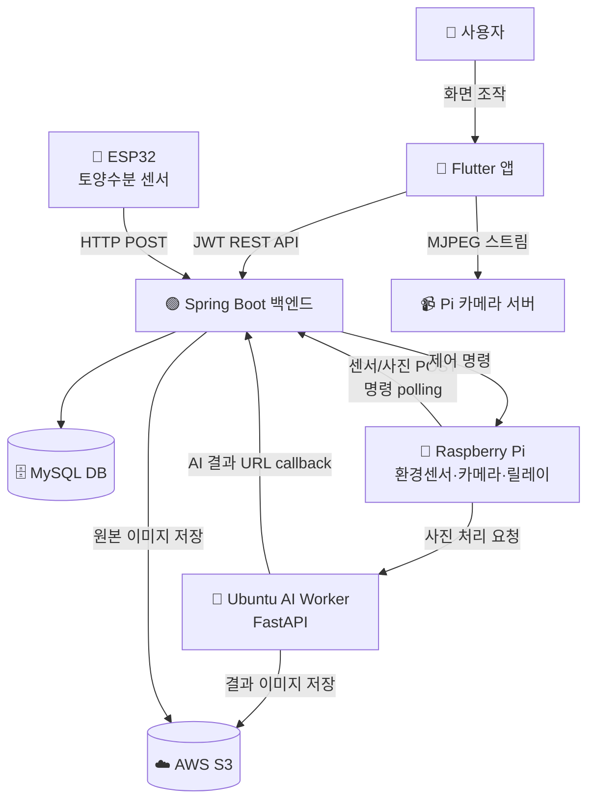

<div align="center">

# 🌱 GreenLink

### 앱 속 반려식물과 현실 식물을 연결하는 IoT 기반 식물 성장 서비스

**V2R (Virtual-to-Reality) Plant Growth Platform**

*One tap, visible change, real harvest.*

[](https://flutter.dev/)
[](https://spring.io/projects/spring-boot)
[](https://www.mysql.com/)
[](https://www.raspberrypi.com/)
[](https://www.espressif.com/)
[](https://openai.com/)
[](https://aws.amazon.com/)

</div>

---

## 📌 프로젝트 소개

**GreenLink**는 사용자가 앱에서 키우는 가상 반려식물을 실제 스마트팜의 식물과 연결하여, 앱 활동이 곧 실제 식물 관리로 이어지는 V2R(Virtual-to-Reality) 식물 성장 서비스입니다.

기존 식물 관리 앱은 시간 기반 알림에 그치지만, GreenLink는 앱에서의 행동(물주기·조명 제어)이 IoT 장치를 통해 실제 식물에 반영되고, 센서·카메라가 그 결과를 다시 앱으로 전달하는 **폐루프(Closed Loop) 경험**을 제공합니다.

> 2026년 봄학기 캡스톤 디자인 2 프로젝트
> 참여기업체: **필로** | 지도교수: **김세진 교수님**

---

## 🎯 해결하고자 한 문제

설문 조사 결과 식물 재배를 지속하지 못하는 주요 이유는 다음과 같았습니다.

| 비율 | 이유 |
|---|---|
| **63.3%** | 관리가 힘들어서 |
| **56.3%** | 식물이 시들어서 |
| **22.6%** | 벌레나 해충 때문 |

기존 솔루션은 다음 한계가 있습니다.

- 📱 **식물 관리 앱** (Greg, Planta, PictureThis): 단순 알림 위주, 실제 식물 상태 미반영
- 🪴 **스마트 식물재배기** (Click & Grow, LG 틔운): 정해진 식물·재배 방식 고정
- 🌾 **원격 스마트팜** (Infarm, 자람): B2B 중심, 개인 사용자 접근 어려움

GreenLink는 **앱 활동 기반 참여 + IoT 기반 실제 관리 + 센서·사진 기반 피드백**을 결합한 **V2R 반려식물 성장 서비스**를 지향합니다.

---

## ✨ 주요 기능

### 🌿 앱 / 식물 관리
- 회원가입·로그인 (이메일, Kakao·Google OAuth)
- 씨앗 사용을 통한 내 식물 생성, 별명 설정, 수확
- 식물 성장 상태 조회 (날짜 기준 GROWING / HARVESTABLE / HARVESTED)
- 인벤토리: 씨앗, 화분, 영양제 보유 및 사용 (영양제 1개당 수확까지 1일 단축)
- 화분 장착 (식물당 1개, 자동 교체)
- 수확 도감 (전체 식물 종 대비 수확 이력)

### 🎮 참여 유도 (게임화)
- 출석 체크 및 연속 출석(streak) 기록
- 일간 / 주간 / 월간 / 업적 퀘스트
- 퀘스트 진행도 자동 추적 (출석·수확 등 이벤트 연동)
- 보상 아이템 자동 지급

### 🌡️ IoT 센서 / 모니터링
- **ESP32 토양수분 센서**: 식물별 토양 수분 % 측정 및 자동 업로드
- **Raspberry Pi 환경 센서**: 온도·습도(DHT22), 조도(BH1750) 측정
- **실시간 MJPEG 영상 스트림**: 재배기 전체 화면 영상 제공
- **센서 기록 그래프**: 토양 수분·온도·습도·조도의 24시간/7일 추이
- **장치 상태 표시**: 조명 켜짐/꺼짐, 최근 명령 실행 결과(완료/실패 사유), 센서 장기 미수신 경고

### 💧 원격 제어 / 자동화
- 앱에서 수동 물주기·조명 제어 명령 전송
- Raspberry Pi 릴레이를 통한 LED·펌프 실제 제어
- 센서값 기반 자동 물주기·조명 판단 (AutomationService)
- 데이터 기반 자동화 임계치 학습 (AutomationLearningService)

### 🎨 AI 이미지 변환
- Raspberry Pi 카메라로 실제 식물 사진 촬영
- OpenAI Images API + rembg 기반 배경·화분 제거
- 앱 스타일 일러스트로 변환 후 S3 저장
- 앱에서 변환된 이미지 표시

### 🛠️ 관리자
- Thymeleaf 기반 운영 대시보드: 사용자·식물 수, 장치 온라인/오프라인, 최근 명령과 24시간 실패 건수
- 사용자·식물·아이템·퀘스트·IoT 장치 관리

---

## 🏗️ 시스템 아키텍처



### 데이터 흐름

| 흐름 | 경로 |
|---|---|
| **제어 요청** | Flutter → Spring Boot → Raspberry Pi → Relay → Pump/LED |
| **센서 데이터** | ESP32/RPi Sensors → Spring Boot → MySQL → Flutter |
| **AI 이미지** | RPi Camera → Spring Boot → Ubuntu AI → OpenAI API → S3 → Flutter |

---

## 🛠️ 기술 스택

<table>
<tr>
<td valign="top" width="50%">

### Frontend
- **Flutter** (Dart `^3.9.2`)
- Material UI
- `http`, `shared_preferences`
- Kakao Flutter SDK
- Google Sign-In

### Backend
- **Spring Boot 4.0.6** (Java 17)
- Spring Security + JWT(jjwt)
- Spring Data JPA
- AWS SDK S3
- Thymeleaf (관리자 화면)
- OAuth2 (Kakao / Google)

### Database
- **MySQL**
- Soft delete 기반 관리
- ddl-auto: update

</td>
<td valign="top" width="50%">

### IoT Devices
- **ESP32** + PlatformIO Arduino
  - 토양수분 ADC (GPIO 34)
- **Raspberry Pi**
  - DHT22 (GPIO 4), BH1750 (I2C 0x23)
  - 릴레이 (GPIO 22, 23, 27)
  - Pi Camera (MJPEG)
- Active-LOW 릴레이 회로

### AI / Image
- **Python 3.11**
- FastAPI (AI Worker API)
- OpenAI Images API
- rembg (배경 제거)
- PIL, NumPy

### Infrastructure (재구축 대상)
- **AWS EC2 또는 Lightsail / S3**
- Nginx + HTTPS
- Cloudflare

</td>
</tr>
</table>

---

## 📂 프로젝트 구조

본 저장소는 **5개 모듈을 단일 모노레포(monorepo)** 로 관리합니다. 각 모듈은 독립적으로 빌드·실행 가능합니다.

```text
greenlink/
├── greenlink_back/      # Spring Boot 백엔드 (REST API, 인증, JPA, 관리자 웹)
├── greenlink_front/     # Flutter 앱 (사용자용 모바일 UI)
├── greenlink_esp/       # ESP32 펌웨어 (토양수분 센서)
├── greenlink_pi/        # Raspberry Pi (환경센서, 카메라, 릴레이 제어)
├── greenlink_ubuntu/    # Ubuntu AI Worker (FastAPI, OpenAI 이미지 변환)
└── docs/                # 기준 문서, 시스템 다이어그램, 판넬 자료
```

각 모듈별 상세 구조와 파일 역할은 `docs/` 폴더 내 다음 문서를 참고하세요.

- `PROJECT_OVERVIEW.md` — 전체 시스템 개요
- `BACKEND.md` — Spring Boot 백엔드
- `FRONTEND.md` — Flutter 앱
- `ESP.md` — ESP32 펌웨어
- `PI.md` — Raspberry Pi
- `UBUNTU_GREENLINK_AI.md` — AI Worker
- `DEPLOYMENT.md` — 학교 서버(winserver WSL Docker + Cloudflare 터널) 백엔드 배포 절차
- `INFRASTRUCTURE_SETUP_GUIDE.md` — 서버·DB·S3·IAM·DNS·TLS·OAuth·OpenAI·IoT 신규 구축 및 운영 절차
- `API_SPECIFICATION.md` — REST API 명세
- `FUNCTIONAL_SPECIFICATION.md` — 기능 명세

---

## ✅ 현재 코드 검증 기준

2026-07-24 소스 기준으로 다음을 확인했습니다.

- Backend: H2 테스트 프로필을 사용한 테스트 17개 통과, `bootJar` 생성 성공
- Ubuntu AI Worker: Python unittest 13개 통과
- Raspberry Pi: WATER 지속시간/worker unit test 5개 통과
- Flutter: 저장소에 테스트 13개가 있으며, 현재 검증 환경에는 Flutter/Dart SDK가 없어 실행하지 못함
- 인증·출석·월간 퀘스트 만료·식물 상태 갱신·API 응답 계약·민감한 요청 body 로그를 실제 코드와 맞춤

현재 Backend와 Pi는 WATER 명령을 모두 **0초 초과, 1초 이하**로 제한하는 fail-closed 정책을 적용합니다. `durationSeconds` key가 아예 없을 때만 Pi가 1초를 사용하며, null·문자열·boolean·비유한 수·0 이하·1초 초과 값은 펌프를 켜기 전에 거부하고 명령을 `FAILED`로 보고합니다. 1초는 물리적으로 검증된 최종값이 아니라 실측 전 보수적인 소프트웨어 상한이므로, 펌프 유량과 화분별 안전 급수량을 측정하기 전에는 늘리지 않는 것이 좋습니다. 자세한 산정 방법은 [Raspberry Pi 문서](./docs/PI.md)를 참고하세요.

AI Worker는 설정된 `S3_BUCKET`·`AWS_REGION`으로 만든 정확한 virtual-host HTTPS URL과 `greenlink/userplant/` 아래 단일 이미지 key만 받아 boto3 `get_object()`로 직접 읽습니다. 확장자와 S3 `ContentType`, `ContentLength`, 실제 stream 길이를 대조하고 원본 크기를 20MiB로 제한합니다. boto3 기본 credential provider chain을 사용하므로 Worker 실행 주체에 해당 원본 prefix의 `s3:GetObject`가 허용되어 있으면 사용할 수 있지만, 저장소에는 배포 IAM 정책이 없고 이 검증 환경에서는 AWS live 요청을 실행하지 못했으므로 실제 권한은 운영 서버에서 확인해야 합니다.

새 bucket으로 재구성할 때 현재 HTTPS virtual-host URL 계약에 맞게 점(`.`)이 없는 bucket 이름을 선택하고, Backend와 Worker에 동일한 `S3_BUCKET`·`AWS_REGION`을 주입합니다. Backend에는 원본 prefix의 `s3:PutObject`, Worker에는 원본 prefix의 `s3:GetObject`와 AI 결과 prefix의 `s3:PutObject`만 부여합니다. 단, Backend와 Worker가 반환하는 URL은 서명되지 않은 S3 URL이므로 private bucket에서 Flutter가 `Image.network`로 표시하는 문제는 별도의 presigned URL·인증 proxy·CDN 설계가 필요합니다. 운영 smoke 절차는 [AI Worker 문서](./docs/UBUNTU_GREENLINK_AI.md)를 참고하세요.

## 🚀 실행 방법

> 실행 전, 각 모듈에서 필요한 값(JWT secret, DB 접속, S3 자격증명, OAuth 키, OpenAI API 키, 장치 키 등)을 **외부 설정**으로 주입해야 합니다. 현재 소스와 설정에는 운영 URL·키·자격 정보 계열 값이 일부 포함되어 있으므로, 배포 전 외부화하고 노출 가능성이 있는 값은 교체해야 합니다. 문서에는 실제 값을 기록하지 않습니다.

### 1. Backend (Spring Boot)

```bash
cd greenlink_back
./gradlew bootRun       # 개발 서버 실행
./gradlew test          # 테스트
./gradlew build         # JAR 빌드
```

**필요 설정**: MySQL 접속 정보, JWT secret, `S3_BUCKET`, `AWS_REGION`, AWS 기본 credential provider chain으로 공급되는 실행 자격 증명, OAuth 클라이언트 설정

**최초 기동**: 빈 DB면 기본 식물(바질)과 가입 지급 아이템(바질 씨앗, 기본 화분)이 자동 생성됩니다. ADMIN이 한 명도 없을 때 `GREENLINK_BOOTSTRAP_ADMIN_EMAIL`·`GREENLINK_BOOTSTRAP_ADMIN_PASSWORD`(12자 이상)를 주면 최초 관리자가 생성되며, 생성 후에는 두 환경변수를 제거합니다.

마지막 운영 확인 기록은 JAR를 수동 전송한 뒤 `screen` 세션에서 `java -jar`로 실행하는 방식입니다. Backend systemd unit과 자동 복구는 확인되지 않았습니다.

### 2. Frontend (Flutter)

```bash
cd greenlink_front
flutter pub get
flutter run             # 디바이스/에뮬레이터 실행
flutter build apk       # Android 빌드
flutter build ios       # iOS 빌드
```

**필요 설정**: API base URL, 카메라 스트림 URL, Kakao/Google OAuth 설정

### 3. ESP32 (PlatformIO)

```bash
cd greenlink_esp
pio run                 # 빌드
pio run -t upload       # 보드에 업로드
pio device monitor      # 시리얼 모니터
```

**필요 설정**: Wi-Fi SSID/비밀번호, 서버 endpoint, 장치 키

### 4. Raspberry Pi

```bash
cd greenlink_pi
python3 -m venv .venv
source .venv/bin/activate
# 필요 패키지 설치 (RPi.GPIO, picamera2, adafruit_dht 등)

# 센서 측정 및 업로드
python3 sensor_main.py

# 카메라 MJPEG 스트림 서버
python3 stream_server.py

# 명령 폴링 및 펌프/LED 제어 워커
python3 command_worker.py
```

**필요 설정**: 서버 endpoint, 장치 키, 식물 ID(`GREENLINK_USER_PLANT_ID`), 펌프 GPIO(`GREENLINK_PUMP_GPIO`, 기본 22). 재배기 1대에 식물 1개를 기준으로 하며 카메라는 전체 화면을 사용합니다. (`greenlink.env.example` 참고)

### 5. Ubuntu AI Worker (FastAPI)

```bash
cd greenlink_ubuntu
python3.11 -m venv .venv
source .venv/bin/activate
pip install fastapi uvicorn rembg pillow numpy openai boto3 requests python-dotenv

uvicorn ai_worker_api:app --host 0.0.0.0 --port 9000
```

**필요 설정**: OpenAI API key, `S3_BUCKET`, `AWS_REGION`, AWS 기본 credential provider chain으로 공급되는 실행 자격 증명, Backend callback URL

---

## 📊 구현 현황

| 구분 | 상태 | 비고 |
|---|---|---|
| 회원가입 / 로그인 (일반·OAuth) | ✅ 구현 완료 | Kakao·Google 포함 |
| 식물 등록 / 성장 / 수확 | ✅ 구현 완료 | 날짜 기준 상태 전환 |
| 인벤토리 / 화분 장착 / 영양제 | ✅ 구현 완료 | |
| 출석 / 퀘스트 / 도감 | ✅ 구현 완료 | ATTEND·HARVEST 자동 연동 |
| ESP32 토양수분 측정 | ✅ 구현 완료 | 10분 주기 |
| Pi 환경 센서 / 카메라 스트림 | ✅ 구현 완료 | DHT22, BH1750, MJPEG |
| 수동 / 자동 물주기 · 조명 | ⚠️ 부분 구현 | DeviceCommand 기반, Backend/Pi 양쪽 WATER 1초 상한 적용. 물리 유량 보정 필요 |
| AI 이미지 변환 (OpenAI + rembg) | ⚠️ 부분 구현 | 검증된 S3 원본 직접 읽기/결과 저장 구현. `/process` 인증·live IAM·private 이미지 전달 검증 필요 |
| Admin Dashboard | ⚠️ 부분 구현 | Thymeleaf 및 JWT cookie 로그인, CSRF/HttpOnly 정책 검토 필요 |
| Nginx + HTTPS 배포 | ⚠️ 재구축 필요 | 현재 서버가 없으며 신규 DNS·TLS·서비스 운영 설정이 필요 |

---

## 🏆 차별점

| 기능 영역 | 식물 관리 앱 | 스마트 재배기 | 원격 스마트팜 | **GreenLink** |
|---|:---:|:---:|:---:|:---:|
| 식물 등록 / 도감 | ◯ | ◯ | △ | **◯** |
| 실제 재배기 연동 | ✕ | ◯ | ◯ | **◯** |
| 센서 데이터 확인 | ✕ | △ | △ | **◯** |
| 앱에서 원격 제어 | ✕ | △ | △ | **◯** |
| 앱 활동 ↔ 실제 연동 | ✕ | △ | ✕ | **◯** |
| 퀘스트 / 아이템 게임화 | △ | ✕ | ✕ | **◯** |
| 반려식물 성장 경험 | ◯ | △ | ✕ | **◯** |

---

## 👥 팀

| 이름 | GitHub |
|---|---|
| **안광은** | [@Age-Code](https://github.com/Age-Code) |
| **김민제** | [@MinJe21](https://github.com/MinJe21) |

**지도교수**: 김세진 교수님
**참여기업체**: 필로

---

## 📄 문서

자세한 기술 문서는 `docs/` 폴더를 참고하세요.

- 📐 [시스템 개요](./docs/PROJECT_OVERVIEW.md)
- 🟢 [백엔드 분석](./docs/BACKEND.md)
- 📱 [프론트엔드 분석](./docs/FRONTEND.md)
- 🔌 [ESP32 펌웨어](./docs/ESP.md)
- 🍓 [Raspberry Pi](./docs/PI.md)
- 🐧 [AI Worker](./docs/UBUNTU_GREENLINK_AI.md)
- 🏗️ [신규 인프라 구축·운영 가이드](./docs/INFRASTRUCTURE_SETUP_GUIDE.md)
- 🔗 [API 명세](./docs/API_SPECIFICATION.md)
- 📋 [기능 명세](./docs/FUNCTIONAL_SPECIFICATION.md)

---

<div align="center">

**🌱 GreenLink — 앱 활동이 실제 식물 관리로 이어지는 V2R 반려식물 성장 서비스**

2026 봄학기 캡스톤 디자인 2

</div>
