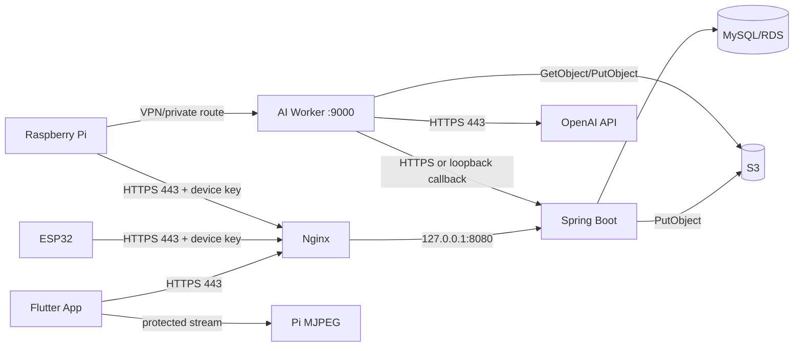

# GreenLink 신규 인프라 구축·운영 가이드

> **2026-11 변경**: AI 이미지 변환(OpenAI + rembg, Ubuntu AI Worker, `/api/ai/**`, `AiPlantImage`)과 AWS S3 저장은 제거되었습니다. 현재는 Raspberry Pi가 매일 09:00 실시간 영상에서 한 장을 캡처해 업로드하고, 백엔드가 서버 디스크(Docker 볼륨)에 저장해 `/images/**`로 제공하며 앱 썸네일로 씁니다. 재배기 1대 = 식물 1개 구성입니다. 아래 본문의 AI/S3 관련 내용은 이전 구성 기록입니다.

> 기준 소스: 2026-07-24 현재 저장소  
> 현재 상태: 운영 서버 없음, S3 bucket 없음, 운영 DB 없음  
> 목적: 코드 밖에서 준비해야 하는 계정, 서버, 네트워크, DB, S3, IAM, DNS, TLS, OAuth, OpenAI, 모바일 서명, IoT 장치 및 운영 절차를 처음부터 다시 구성한다.

이 문서는 과거 서버를 복원하는 기록이 아니라 **새 환경을 만드는 greenfield runbook**이다. 실제 비밀번호, API key, 장치 key, 계정 번호 및 기존 서버 주소는 기록하지 않는다. 모든 예제의 `<...>`는 실제 값으로 치환해야 하며, `<`와 `>`를 그대로 설정에 넣으면 안 된다.

AWS, OpenAI, OAuth 제공자 콘솔의 메뉴명과 요금은 바뀔 수 있다. 실행 당일에는 문서 마지막의 공식 링크에서 현재 화면과 조건을 다시 확인한다.

---

## 0. 먼저 읽을 결론

### 권장 기준 구성

첫 재구축은 다음 구성을 기준으로 한다.

- AWS Region: 사용자와 가까운 단일 Region. 한국 사용자 중심이면 일반적으로 서울 Region을 검토한다.
- Compute: Ubuntu LTS 기반 EC2.
- AWS 자격 증명: EC2 IAM instance role. 서버에 장기 AWS access key를 저장하지 않는다.
- Object storage: Compute와 같은 Region의 일반 목적 S3 bucket.
- DB: 초기 소규모 검증은 같은 EC2의 localhost MySQL, 실제 운영은 RDS MySQL을 우선 검토한다.
- Edge: Nginx가 80/443만 받고 Backend는 `127.0.0.1:8080`에 bind한다.
- AI Worker: 같은 서버라면 `127.0.0.1:9000`; Raspberry Pi에서 호출해야 하므로 VPN 또는 엄격한 네트워크 allowlist를 별도로 둔다.
- Process manager: Backend와 AI Worker 모두 systemd.
- TLS: 공인 도메인 + Let's Encrypt 또는 조직이 관리하는 인증서.
- S3 encryption: 우선 SSE-S3. SSE-KMS는 private image delivery까지 설계한 뒤 적용한다.
- Pump safety: Backend와 Raspberry Pi 모두 현재의 **최대 1초 fail-closed 상한**을 유지한다.

EC2를 권장하는 가장 큰 이유는 Backend의 AWS SDK와 AI Worker의 boto3가 모두 기본 credential provider chain을 사용하기 때문이다. EC2 instance role을 붙이면 장기 access key 없이 현재 코드가 자격 증명을 찾을 수 있다. Lightsail 또는 일반 VPS도 가능하지만, 표준 S3에 접근할 workload identity를 별도로 설계해야 한다.

### 배포 전 반드시 해결할 코드 측 gate

아래 항목은 AWS나 서버 콘솔 설정만으로 완전히 해결되지 않는다. 새 인프라를 만들 수는 있지만, 이 gate를 닫기 전에는 전체 서비스를 운영 공개하지 않는다.

| Gate | 현재 코드 상태 | 필요한 조치 |
| --- | --- | --- |
| Backend URL | Pi, ESP, AI Worker callback에 과거 HTTP 주소가 하드코딩됨 | HTTPS 도메인 또는 private URL을 환경별 설정으로 외부화하고 테스트 |
| AI Worker inbound 인증 | `POST /process`에 application-level 인증이 없음 | 우선 VPN/allowlist로 닫고, 이후 shared secret·mTLS·서명 중 하나 구현 |
| S3 이미지 공개 방식 | DB에 서명 없는 S3 URL을 저장하고 Flutter가 직접 읽음 | prototype public-read 또는 production private delivery 중 하나를 명시적으로 선택 |
| Private S3 전환 | Worker는 query가 붙은 presigned URL과 CloudFront host를 거부 | Worker에는 stable S3 key를 전달하고 앱 응답만 서명/프록시하는 코드 설계 필요 |
| 빈 DB bootstrap | seed/migration과 최초 ADMIN 생성 경로가 없음 | 통제된 seed SQL 또는 정식 migration/initializer 추가 |
| OAuth | Flutter의 provider ID/redirect 설정이 코드에 고정됨 | 새 앱 등록값 반영 후 실제 Kakao/Google 기기 테스트 |
| ESP HTTPS | 현재 firmware는 과거 HTTP endpoint 사용 | CA 검증을 포함한 HTTPS 통신으로 수정·실장치 검증 |
| 재현 가능한 Python 설치 | AI/Pi에 requirements/lock 파일이 없음 | 실서버 검증 후 dependency lock 생성 |
| AI 작업 내구성 | FastAPI in-process `BackgroundTasks`이며 queue/status/retry 없음 | 단일 worker·제한된 ingress로 시작하고 운영 전 영속 queue 검토 |
| 카메라 보안 | MJPEG endpoint 자체 인증이 없음 | VPN 또는 인증 proxy 도입 전 인터넷 공개 금지 |

### 구축 완료의 판정 기준

다음 항목이 모두 증거와 함께 통과해야 “구축 완료”로 판정한다.

1. EC2 service identity로 `aws sts get-caller-identity`가 기대한 role을 반환한다.
2. Backend 권한으로 원본 prefix에 PUT할 수 있고, 허용되지 않은 prefix에는 실패한다.
3. Worker 권한으로 원본을 GET하고 AI 결과 prefix에 PUT할 수 있다.
4. Backend test 17개와 `bootJar`, AI unit test 13개, Pi unit test 5개가 통과한다.
5. MySQL에 새 schema가 생기고 최소 seed 후 회원가입·로그인이 성공한다.
6. 외부에서는 443만으로 Backend에 접근하고 3306, 8080, 9000은 열려 있지 않다.
7. TLS 자동 갱신 dry-run이 성공한다.
8. Worker `/health`뿐 아니라 한 건의 허용된 유료 end-to-end 이미지 작업이 S3 결과와 DB callback까지 완료된다.
9. Pi는 펌프 전원을 분리한 상태에서 명령 polling을 검증한 후, 물받이를 두고 최대 1초만 실측한다.
10. DB backup을 별도 restore-test DB에 실제 복원한다.
11. 현재 source에 들어 있거나 과거에 사용한 모든 secret, device key, Wi-Fi password는 재사용하지 않고 회전한다.

---

## 1. 범위, 가정 및 환경 분리

### 이 문서가 다루는 것

- AWS 계정 보안, 예산 및 IAM
- EC2 또는 대체 compute 선택
- Ubuntu, 방화벽, OS 사용자, 디렉터리
- MySQL 생성, 접속, backup 및 restore
- S3 생성, public/private 선택, IAM, encryption, versioning, lifecycle, CORS
- Spring Boot build artifact와 systemd 배포
- AI Worker Python 환경, OpenAI project/key, systemd 배포
- Nginx, DNS, TLS
- Kakao 및 Google OAuth 외부 콘솔
- Flutter Android/iOS package, signing 및 provider 설정
- Raspberry Pi OS, 카메라, 센서, GPIO, systemd/timer
- ESP32 Wi-Fi, endpoint, device 등록 및 센서 보정
- 빈 DB master data와 IoT 연결 순서
- 전체 smoke test, monitoring, backup, rotation, 장애 복구

### 이 문서가 자동으로 해결하지 않는 것

- source에 하드코딩된 URL/key/ID의 외부화
- private S3용 presigned URL 또는 authenticated image proxy
- AI Worker `/process` 인증
- persistent job queue와 재시도
- DB schema migration 도구
- Backend의 정식 `/health` endpoint
- Flutter release signing 파일 생성 자체
- 실제 OAuth 제공자 심사 승인
- 실제 펌프 유량과 안전 급수량 결정

### 환경은 최소 두 개로 분리

가능하면 다음을 섞지 않는다.

| 환경 | 목적 | 분리해야 할 항목 |
| --- | --- | --- |
| staging | 외부 연동, migration, 장치 및 OAuth 검증 | EC2/RDS, bucket, OpenAI project, OAuth 앱 또는 client, DB, device key |
| production | 실제 사용자 데이터 | 위 항목 전체, 도메인, budget/alert, backup 보존 |

최소한 bucket과 DB는 환경별로 분리한다. 하나의 bucket을 쓴다면 prefix만 나누는 것보다 실수의 영향 범위가 크다. OpenAI도 project를 분리하면 key와 사용 한도를 환경별로 관리하기 쉽다.

---

## 2. 현재 코드와 새 인프라의 정확한 계약

### Backend

- Java 17 toolchain, Spring Boot 4.0.6, Gradle Wrapper 9.4.1.
- runtime DB driver는 MySQL Connector/J.
- datasource 설정은 저장소에 없으므로 외부 설정이 필수다.
- JPA는 현재 `ddl-auto: update`, SQL 출력은 `true`, SQL init은 `never`다.
- OAuth client component가 기동 시 필수 property를 읽으므로 OAuth를 실제로 쓰지 않더라도 placeholder를 누락하면 application context가 실패할 수 있다.
- S3는 `DefaultCredentialsProvider`를 사용한다.
- S3 원본 key는 `greenlink/userplant/`로 고정되어 있다.
- 반환 URL은 `https://<bucket>.s3.<region>.amazonaws.com/<key>`로 고정되어 있다.
- 이미지 확장자는 jpg/jpeg/png/webp만 허용하며 확장자와 MIME이 정확히 일치해야 한다.
- 파일은 20MiB 이하만 허용한다.
- 별도 `/health` 또는 Actuator endpoint는 없다. 코드 변경 전에는 공개 `GET /api/plants`를 제한적인 liveness+DB smoke로 쓴다.

### AI Worker

- Python 문법상 최소 3.10이 필요하고 프로젝트 기준은 Python 3.11이다.
- `OPENAI_API_KEY`, `S3_BUCKET`, `AWS_REGION`, `AI_WORKER_SECRET`을 사용한다.
- boto3 default credential provider chain을 사용한다.
- 원본 URL은 아래 형태만 허용한다.

```text
https://<S3_BUCKET>.s3.<AWS_REGION>.amazonaws.com/greenlink/userplant/<single-file>
```

- query, fragment, userinfo, 다른 port, 다른 host, path-style URL, CloudFront URL, 중첩 경로를 거부한다.
- 파일명은 `[A-Za-z0-9._-]+` 범위의 단일 파일이어야 한다.
- S3 `ContentType`, `ContentLength`, 실제 stream 길이와 20MiB 상한을 검사한다.
- 결과 key는 `greenlink/ai/userplant/<원본-stem>.png`다.
- 결과는 같은 원본 stem을 재처리하면 같은 key를 overwrite할 수 있다.
- `BACKEND_BASE_URL`은 FastAPI 경로에서 환경 변수로 외부화되어 있지 않다.
- `/process` 성공 응답은 작업 접수만 의미한다. 실제 작업 실패는 background log에만 남을 수 있다.

### Raspberry Pi

- Backend URL, Worker URL, device key, 두 userPlant ID와 설치 경로가 `config.py`에 고정되어 있다.
- 실행 shell script도 `/home/greenlink/greenlink`를 고정 사용한다.
- 카메라 stream은 `0.0.0.0:8000`에 bind하고 자체 인증이 없다.
- relay는 active-low를 전제로 하고 GPIO 22, 23, 27을 사용한다.
- WATER duration은 key가 없을 때만 1초를 사용하며, 0초 이하·1초 초과·문자열·boolean·null·NaN/Infinity를 거부한다.

### ESP32

- Wi-Fi SSID/password, Backend endpoint, device key가 source에 고정되어 있다.
- Backend에 직접 HTTP POST한다.
- device key를 serial log에 출력한다.
- soil calibration의 dry/wet raw 값은 설치한 센서와 흙에서 다시 측정해야 한다.

### Flutter

- API base URL과 camera stream URL이 source 상수다.
- Kakao native app key/redirect scheme과 Google client ID가 source/Info.plist에 고정되어 있다.
- Android application ID와 namespace가 아직 예제 식별자다.
- Android release build가 debug signing을 사용한다.
- iOS bundle ID와 signing team을 정식 값으로 확정해야 한다.
- S3 URL을 `Image.network`로 직접 읽으므로 private bucket에서는 현재 그대로 표시되지 않는다.

---

## 3. 권장 아키텍처와 네트워크 경계



### 기본 port 정책

| Port | 위치 | 외부 공개 | 정책 |
| --- | --- | --- | --- |
| 22 | EC2 SSH | 제한 공개 | 관리자 고정 IP 또는 VPN에서만 |
| 80 | Nginx | 공개 | 인증서 발급과 443 redirect |
| 443 | Nginx | 공개 | App/Pi/ESP API |
| 3306 | MySQL | 금지 | local MySQL이면 localhost, RDS면 Backend SG만 |
| 8080 | Backend | 금지 | `127.0.0.1` bind |
| 9000 | AI Worker | 금지 | localhost 또는 VPN/private interface |
| 8000 | Pi camera | 금지 | Pi localhost/VPN 뒤에서만 |

`8080`을 다시 인터넷에 열어서 Pi/ESP의 옛 URL을 살리는 방식은 사용하지 않는다. device key와 payload가 평문 HTTP로 노출되고 Nginx/TLS를 우회한다.

### 권장 도메인

예시는 다음과 같다.

```text
api.<YOUR_DOMAIN>       Backend API와 admin
worker.<YOUR_DOMAIN>    꼭 필요한 경우에만, Pi source로 제한
camera.<YOUR_DOMAIN>    인증/VPN 설계가 끝난 경우에만
```

- 초기 DNS TTL은 300초 정도로 두고 안정화 후 늘릴 수 있다.
- IPv6를 실제 구성하지 않았다면 AAAA record를 만들지 않는다.
- EC2에는 Elastic IP를 연결하거나 DNS가 안정적으로 가리킬 고정 ingress를 사용한다.

---

## 4. 준비할 값과 secret inventory

먼저 암호화된 password manager 또는 조직 secret manager에 아래 표를 만든다. 실제 값은 이 Markdown에 쓰지 않는다.

| 이름 | 예시 placeholder | 생성/소유 주체 | 사용 위치 |
| --- | --- | --- | --- |
| AWS account ID | `<AWS_ACCOUNT_ID>` | AWS | IAM policy ARN |
| Region | `<AWS_REGION>` | 운영 결정 | Backend, Worker, CLI |
| S3 bucket | `<S3_BUCKET>` | AWS | Backend, Worker |
| API domain | `<API_DOMAIN>` | DNS | App, Pi, ESP, Nginx |
| Worker private URL | `<AI_WORKER_URL>` | 네트워크 | Pi |
| Camera URL | `<CAMERA_URL>` | 네트워크 | Flutter |
| DB name | `greenlink` | DBA | MySQL, Backend |
| DB user | `greenlink_app` | DBA | Backend |
| DB password | `<DB_PASSWORD>` | DBA | Backend external config |
| JWT secret | `<JWT_SECRET>` | Backend 운영자 | Backend |
| AI callback secret | `<AI_WORKER_SECRET>` | Backend/AI 운영자 | Backend와 Worker 동일값 |
| OpenAI API key | `<OPENAI_API_KEY>` | OpenAI project owner | Worker |
| Kakao native app key | `<KAKAO_NATIVE_APP_KEY>` | Kakao app owner | Flutter |
| Kakao REST API key | `<KAKAO_REST_API_KEY>` | Kakao app owner | Backend token exchange |
| Kakao client secret | `<KAKAO_CLIENT_SECRET>` | Kakao app owner | Backend, 활성화했을 때 |
| Google mobile client ID | `<GOOGLE_MOBILE_CLIENT_ID>` | Google Cloud | Flutter |
| Google server client ID | `<GOOGLE_SERVER_CLIENT_ID>` | Google Cloud | Flutter와 Backend |
| Google server secret | `<GOOGLE_SERVER_CLIENT_SECRET>` | Google Cloud | Backend만 |
| Pi device key | `<PI_DEVICE_KEY>` | GreenLink operator | DB와 Pi |
| ESP device key | `<ESP_DEVICE_KEY_n>` | GreenLink operator | DB와 각 ESP |
| Android application ID | `<ANDROID_APPLICATION_ID>` | App owner | Android/Kakao/Google/store |
| iOS bundle ID | `<IOS_BUNDLE_ID>` | App owner | Apple/Kakao/Google |

### 안전한 랜덤값 생성 예

운영자 로컬의 신뢰할 수 있는 머신에서 생성하고 password manager에 즉시 저장한다.

```bash
openssl rand -base64 48   # JWT secret 후보: 최소 32 bytes 이상
openssl rand -hex 32      # AI worker secret 또는 device key 후보
openssl rand -base64 36   # DB password 후보
```

- shell history에 실제 password를 직접 입력하지 않는다.
- 기존 source에 있던 값은 공개되었다고 간주하고 다시 사용하지 않는다.
- Pi와 ESP마다 고유 device key를 사용한다.
- key 이름에 사람/식물 이름이나 serial number만 쓰지 않는다.

---

## 5. 계정, 소유권과 예산

### AWS

1. Root account에 MFA를 활성화한다.
2. 일상 작업은 root가 아닌 IAM Identity Center 또는 관리용 IAM identity로 한다.
3. billing contact와 security contact를 실제 담당자 메일로 둔다.
4. 월 예산과 50%, 80%, 100% alert를 설정한다.
5. EC2, EBS, Elastic IP, RDS, S3 storage/request, data transfer, CloudWatch가 비용 항목임을 기록한다.
6. runtime role과 인프라 생성용 admin identity를 분리한다.
7. CloudTrail 기본 management event를 유지한다. S3 data event는 비용을 확인한 뒤 필요한 bucket/prefix에 선택적으로 켠다.

### OpenAI

1. production 전용 Project를 만든다.
2. 사람의 개인 key가 아니라 해당 project용 service account 또는 project key를 사용한다.
3. key 권한은 이미지 edit에 필요한 endpoint만 허용하는 restricted key를 우선 검토한다.
4. project budget/usage limit과 알림 수신자를 설정한다.
5. key는 모바일 앱, ESP, Pi source 또는 Git에 절대 넣지 않는다.
6. 현재 코드는 `gpt-image-1.5`를 명시한다. 모델 변경은 별도 품질/비용 회귀 테스트 없이 하지 않는다.

OpenAI는 API key를 환경 변수로 주입하고, 환경별 project/key를 분리할 것을 안내한다. [API key 안전 지침](https://help.openai.com/en/articles/5112595), [project 기반 key 관리](https://help.openai.com/en/articles/5008148), [key 권한 설정](https://help.openai.com/en/articles/8867743-assign-api-key-permissions)을 참고한다.

### 기타 외부 계정

- Domain registrar/DNS account: 조직 계정, MFA, 자동 갱신, 결제 수단 확인.
- Kakao Developers: 조직 소유 app과 복수 관리자.
- Google Cloud/Play Console: 조직 project와 복수 관리자.
- Apple Developer/App Store Connect: 조직 team과 복수 관리자.
- 모든 계정에 “소유자, backup owner, 결제 담당, 복구 수단”을 기록한다.

---

## 6. Compute 선택

### A. EC2 — 권장

장점:

- instance role을 통한 단기 AWS 자격 증명.
- Security Group과 VPC에서 network 경계를 명확히 설정.
- RDS/S3와 같은 AWS 자원 연결이 단순.

초기 sizing은 실제 부하를 모르는 추정치다.

- Backend + local MySQL만: 2 vCPU, 4GiB RAM부터 검토.
- Backend + MySQL + AI Worker: AI 전처리와 ONNX model 때문에 2 vCPU, 8GiB RAM 이상을 우선 검토.
- EBS: 암호화된 gp3 30~50GiB부터 시작하고 disk alert를 둔다.
- OpenAI가 이미지 생성을 처리하더라도 `rembg`/Pillow/ONNX는 서버 RAM과 CPU를 사용한다.

### B. Lightsail

고정 가격과 단순 UI는 장점이지만 일반 EC2 instance profile과 같은 방식으로 표준 S3 role을 붙인다고 가정하면 안 된다. Lightsail object storage의 resource access는 별도 서비스 개념이며, 현재 코드의 표준 regional S3 virtual-host URL 계약과 drop-in 호환이라고 단정할 수 없다.

Lightsail에서 표준 S3를 사용할 경우:

- 전용 최소 권한 access key를 보호된 systemd EnvironmentFile에 넣는 fallback을 쓸 수 있다.
- key rotation 일정과 유출 대응 절차가 필수다.
- 장기적으로 IAM Roles Anywhere, 별도 AWS compute 또는 다른 workload identity를 검토한다.

### C. 일반 VPS/온프레미스

가능하지만 AWS role을 자동으로 받을 수 없다. 전용 IAM user access key는 최후의 단순 fallback이며:

- 사람용 key와 분리한다.
- source나 `.env`를 Git에 넣지 않는다.
- `/etc/greenlink/*.env`를 root 소유 0640 이하로 둔다.
- 최소 권한과 정기 rotation을 적용한다.
- `AWS_SESSION_TOKEN`이 있는 임시 credential이면 만료/갱신 방식도 설계한다.

---

## 7. EC2와 기본 네트워크 생성

### VPC/Security Group

작은 초기 구성은 default VPC에서도 가능하지만 production은 public/private subnet을 구분하는 편이 좋다.

Backend EC2 inbound 예:

| Protocol | Port | Source |
| --- | --- | --- |
| TCP | 22 | `<ADMIN_PUBLIC_IP>/32` 또는 VPN subnet |
| TCP | 80 | `0.0.0.0/0`, `::/0` |
| TCP | 443 | `0.0.0.0/0`, `::/0` |

추가하지 않을 inbound:

- 3306
- 8080
- 9000

AI Worker를 별도 instance에 두면 9000은 internet CIDR이 아니라 Pi VPN subnet 또는 앞단 private proxy Security Group에서만 허용한다.

### EC2 생성 체크

1. 지원되는 Ubuntu LTS image를 선택한다.
2. 이 가이드의 기준선은 Ubuntu 24.04 LTS다.
3. EC2/EBS encryption을 활성화한다.
4. IMDSv2 required를 설정한다.
5. 종료 방지와 EBS delete-on-termination 정책을 환경에 맞게 확인한다.
6. key pair는 안전하게 저장하거나 AWS Systems Manager Session Manager를 사용한다.
7. Elastic IP를 연결한다.
8. hostname/tag에 environment와 owner를 표시한다.
9. 생성 직후 package update와 reboot 필요 여부를 확인한다.

Ubuntu는 production에 LTS 사용을 권장할 수 있으며 release 수명은 [Ubuntu release cycle](https://ubuntu.com/about/release-cycle)에서 확인한다. 26.04 LTS 등 더 새로운 LTS를 선택할 경우 Python native dependency와 camera/ONNX 조합을 다시 검증한다.

### EC2 IAM role 연결

EC2 생성 시 또는 이후에 IAM role을 instance profile로 연결한다. AWS의 공식 절차는 [EC2에 IAM role 연결](https://docs.aws.amazon.com/AWSEC2/latest/UserGuide/attach-iam-role.html)을 참고한다.

처음부터 `AmazonS3FullAccess`를 붙이지 않는다. 이 문서의 prefix 제한 policy를 사용한다.

---

## 8. Ubuntu 기본 설정

### update와 기본 package

```bash
sudo apt update
sudo apt full-upgrade -y
sudo apt install -y \
  ca-certificates \
  curl \
  git \
  jq \
  nginx \
  openjdk-17-jre-headless \
  mysql-server \
  python3 \
  python3-venv \
  python3-pip \
  unzip \
  awscli
sudo timedatectl set-timezone Asia/Seoul
sudo systemctl enable --now systemd-timesyncd
```

AI Worker의 정확한 Python 3.11 공급 방법과 native package는 dependency lock을 만든 뒤 고정한다. Ubuntu 기본 Python을 무리하게 대체하지 않는다.

### 전용 사용자와 디렉터리

```bash
sudo useradd \
  --system \
  --user-group \
  --create-home \
  --home-dir /opt/greenlink \
  --shell /usr/sbin/nologin \
  greenlink

sudo install -d -o root -g greenlink -m 0750 /etc/greenlink
sudo install -d -o greenlink -g greenlink -m 0750 /opt/greenlink/backend
sudo install -d -o greenlink -g greenlink -m 0750 /opt/greenlink/backend/releases
sudo install -d -o greenlink -g greenlink -m 0750 /opt/greenlink/ai
sudo install -d -o greenlink -g greenlink -m 0750 /opt/greenlink/ai/releases
sudo install -d -o greenlink -g greenlink -m 0750 /opt/greenlink/models
sudo install -d -o greenlink -g greenlink -m 0750 /var/log/greenlink
```

서비스를 root로 실행하지 않는다.

### host firewall

Security Group과 별도로 UFW를 쓸 수 있다.

```bash
sudo ufw default deny incoming
sudo ufw default allow outgoing
sudo ufw allow OpenSSH
sudo ufw allow 'Nginx Full'
sudo ufw enable
sudo ufw status verbose
```

SSH source를 UFW에서도 제한할 수 있다면 `OpenSSH` 전체 허용 대신 관리자 CIDR을 명시한다. 원격 session을 끊기 전에 새 rule로 다시 접속 가능한지 확인한다.

### SSH 기본 보안

- password authentication을 끄고 key/SSM을 사용한다.
- root login을 끈다.
- 관리자 public key 분실 시 복구 방법을 사전에 확인한다.
- unattended security updates 사용 여부와 reboot window를 정한다.
- `journalctl`, disk, memory, inode 사용량 alert를 둔다.

---

## 9. MySQL 구축

### 선택 1: 같은 EC2의 MySQL

초기 검증에 단순하지만 Backend/DB 장애 영역과 disk가 같다.

```bash
sudo systemctl enable --now mysql
sudo mysql_secure_installation
sudo ss -lntp | grep 3306
```

`/etc/mysql/mysql.conf.d/mysqld.cnf`에서 `bind-address = 127.0.0.1`인지 확인한다. 변경 후:

```bash
sudo systemctl restart mysql
sudo ss -lntp | grep 3306
```

### DB와 application user 생성

실제 password를 SQL history에 남기지 않도록 관리자 절차를 정한다. 아래는 구조 예시다.

```sql
CREATE DATABASE greenlink
  CHARACTER SET utf8mb4
  COLLATE utf8mb4_0900_ai_ci;

CREATE USER 'greenlink_app'@'localhost'
  IDENTIFIED BY '<DB_PASSWORD>';

GRANT ALL PRIVILEGES ON greenlink.* TO 'greenlink_app'@'localhost';
FLUSH PRIVILEGES;
```

현재 `ddl-auto: update`가 schema를 생성/변경하므로 초기 application user에 DDL 권한이 필요할 수 있다. 장기 운영에서는 Flyway/Liquibase 같은 migration을 도입한 후:

- migration identity에 DDL 권한
- runtime identity에는 필요한 DML 권한
- Backend는 `ddl-auto: validate` 또는 `none`

으로 분리한다.

### 선택 2: RDS MySQL

production 권장 검토 항목:

- private subnet
- public access disabled
- inbound 3306 source는 Backend Security Group만
- storage encryption
- automated backup과 retention
- deletion protection
- Multi-AZ 필요성
- parameter group timezone/charset
- TLS connection
- maintenance window와 minor version update 정책

RDS를 쓰면 datasource URL의 host만 RDS endpoint로 바꾸며 password를 source에 넣지 않는다.

### Backend datasource URL

local MySQL 예:

```text
jdbc:mysql://127.0.0.1:3306/greenlink?useUnicode=true&characterEncoding=UTF-8&serverTimezone=Asia/Seoul
```

RDS는 TLS 설정과 CA bundle을 조직 기준에 맞게 추가한다. `allowPublicKeyRetrieval=true` 또는 TLS 비활성화를 복사해서 해결하지 말고 인증 방식과 Connector/J 문서를 확인한다.

### DB 검증

```bash
mysql \
  --host=127.0.0.1 \
  --user=greenlink_app \
  --password \
  --execute='SELECT VERSION(), CURRENT_TIMESTAMP, @@character_set_database;' \
  greenlink
```

password는 prompt에 입력한다.

---

## 10. S3 bucket 생성과 운영 모드 선택

### bucket 이름 규칙

현재 Worker URL parser와 HTTPS TLS 호환을 위해:

- 소문자, 숫자, hyphen 위주
- 점(`.`)을 사용하지 않음
- 전 세계에서 고유
- 환경 이름 포함
- Backend와 Worker가 사용하는 Region과 동일

예:

```text
greenlink-prod-images-<UNIQUE_SUFFIX>
```

bucket을 삭제하면 같은 이름을 다시 확보할 수 있다고 보장되지 않는다. DB에는 전체 bucket URL이 저장되므로 이름이 바뀌면 과거 record도 migration해야 한다.

### 기본 bucket 생성

서울 Region 예시는 실제 선택 Region으로 바꾼다.

```bash
aws s3api create-bucket \
  --bucket '<S3_BUCKET>' \
  --region '<AWS_REGION>' \
  --create-bucket-configuration LocationConstraint='<AWS_REGION>'
```

`us-east-1`은 CreateBucket API 문법이 다를 수 있으므로 공식 문서를 확인한다.

소유권과 ACL:

```bash
aws s3api put-bucket-ownership-controls \
  --bucket '<S3_BUCKET>' \
  --ownership-controls 'Rules=[{ObjectOwnership=BucketOwnerEnforced}]'
```

기본 encryption:

```bash
aws s3api put-bucket-encryption \
  --bucket '<S3_BUCKET>' \
  --server-side-encryption-configuration \
  'Rules=[{ApplyServerSideEncryptionByDefault={SSEAlgorithm=AES256},BucketKeyEnabled=false}]'
```

versioning:

```bash
aws s3api put-bucket-versioning \
  --bucket '<S3_BUCKET>' \
  --versioning-configuration Status=Enabled
```

tag:

```bash
aws s3api put-bucket-tagging \
  --bucket '<S3_BUCKET>' \
  --tagging 'TagSet=[{Key=Project,Value=GreenLink},{Key=Environment,Value=production},{Key=Owner,Value=<OWNER>}]'
```

### Mode A: private bucket — production 권장

Block Public Access를 모두 유지한다.

```bash
aws s3api put-public-access-block \
  --bucket '<S3_BUCKET>' \
  --public-access-block-configuration \
  'BlockPublicAcls=true,IgnorePublicAcls=true,BlockPublicPolicy=true,RestrictPublicBuckets=true'
```

이 모드에서:

- Backend PUT: 가능
- Worker authenticated GET/PUT: 가능
- Flutter naked URL GET: 403

따라서 현재 code 그대로 전체 UI까지 동작하지 않는다. production private 전환 전에 다음 중 하나를 구현한다.

1. DB에는 bucket/key 또는 stable internal URL을 저장한다.
2. Worker 요청에는 `s3Key`를 별도 전달한다.
3. Flutter 응답 시점에만 짧은 presigned URL을 생성한다.
4. 또는 인증 Backend proxy/CloudFront signed URL을 사용한다.
5. 만료되는 presigned URL 자체를 DB에 영구 저장하지 않는다.

Worker는 query가 붙은 presigned URL과 CloudFront host를 현재 거부하므로 단순히 Backend 반환 URL만 presigned로 바꾸면 Pi → Worker 경로가 깨진다.

### Mode B: 현재 code 무변경 호환 public-read — prototype 한정

사용자 식물 사진이 인터넷의 누구에게나 공개된다. 개인정보/촬영 배경/보존 정책을 검토하고 명시적 승인 없이는 production에서 선택하지 않는다.

공개 write, delete, list는 절대 허용하지 않는다. ACL public은 계속 차단하고 bucket policy 기반 GET만 허용한다.

Public Access Block:

```bash
aws s3api put-public-access-block \
  --bucket '<S3_BUCKET>' \
  --public-access-block-configuration \
  'BlockPublicAcls=true,IgnorePublicAcls=true,BlockPublicPolicy=false,RestrictPublicBuckets=false'
```

bucket policy 예:

```json
{
  "Version": "2012-10-17",
  "Statement": [
    {
      "Sid": "PublicReadOnlyGreenLinkImages",
      "Effect": "Allow",
      "Principal": "*",
      "Action": "s3:GetObject",
      "Resource": [
        "arn:aws:s3:::<S3_BUCKET>/greenlink/userplant/*",
        "arn:aws:s3:::<S3_BUCKET>/greenlink/ai/userplant/*"
      ]
    }
  ]
}
```

위 JSON을 access key가 없는 작업용 파일, 예를 들어 `greenlink-public-read-policy.json`로 저장한 뒤 인프라 관리자 identity로 적용한다.

```bash
aws s3api put-bucket-policy \
  --bucket '<S3_BUCKET>' \
  --policy file://greenlink-public-read-policy.json

aws s3api get-public-access-block \
  --bucket '<S3_BUCKET>'

aws s3api get-bucket-policy-status \
  --bucket '<S3_BUCKET>'
```

public mode에서는 `get-bucket-policy-status`가 public policy를 보고하는 것이 예상 결과다. private mode에서 이 결과가 public이면 배포를 중지한다.

적용 전 account/organization level Block Public Access와 SCP도 확인한다. AWS는 Block Public Access를 기본 안전장치로 권장한다. [S3 Block Public Access](https://docs.aws.amazon.com/AmazonS3/latest/userguide/access-control-block-public-access.html)를 참고한다.

### 두 모드 공통 주의

- public/private는 CORS와 다른 개념이다.
- native Android/iOS SDK 또는 Backend/Worker SDK에는 S3 CORS가 필요하지 않다.
- Flutter Web에서 browser가 직접 읽는 경우에만 exact origin과 GET/HEAD를 CORS에 추가한다.
- CORS는 접근 권한을 부여하지 않는다.
- website endpoint, accelerate, dualstack, access point URL은 현재 Worker가 허용하지 않는다.

### CORS가 정말 필요한 경우

```json
[
  {
    "AllowedOrigins": ["https://<WEB_APP_DOMAIN>"],
    "AllowedMethods": ["GET", "HEAD"],
    "AllowedHeaders": ["*"],
    "ExposeHeaders": ["ETag", "Content-Length", "Content-Type"],
    "MaxAgeSeconds": 300
  }
]
```

적용:

```bash
aws s3api put-bucket-cors \
  --bucket '<S3_BUCKET>' \
  --cors-configuration file://greenlink-cors.json

aws s3api get-bucket-cors \
  --bucket '<S3_BUCKET>'
```

`*` origin을 습관적으로 쓰지 않는다. 공식 예시는 [S3 CORS](https://docs.aws.amazon.com/AmazonS3/latest/userguide/ManageCorsUsing.html)를 참고한다.

---

## 11. S3 runtime IAM

### 같은 EC2에서 Backend와 Worker를 실행하는 경우

하나의 instance role을 공유하므로 OS process별 IAM 분리는 되지 않는다. role은 두 서비스 권한의 합집합을 갖는다.

```json
{
  "Version": "2012-10-17",
  "Statement": [
    {
      "Sid": "WriteOriginalPlantImages",
      "Effect": "Allow",
      "Action": [
        "s3:PutObject"
      ],
      "Resource": "arn:aws:s3:::<S3_BUCKET>/greenlink/userplant/*"
    },
    {
      "Sid": "ReadOriginalPlantImages",
      "Effect": "Allow",
      "Action": [
        "s3:GetObject"
      ],
      "Resource": "arn:aws:s3:::<S3_BUCKET>/greenlink/userplant/*"
    },
    {
      "Sid": "WriteAiPlantImages",
      "Effect": "Allow",
      "Action": [
        "s3:PutObject",
        "s3:AbortMultipartUpload"
      ],
      "Resource": "arn:aws:s3:::<S3_BUCKET>/greenlink/ai/userplant/*"
    }
  ]
}
```

현재 runtime에는 다음 권한이 필요하지 않다.

- `s3:CreateBucket`
- `s3:DeleteBucket`
- `s3:DeleteObject`
- 전체 bucket `s3:ListBucket`
- bucket policy/versioning/lifecycle 변경

### 별도 compute로 분리하는 경우

Backend role:

```json
{
  "Version": "2012-10-17",
  "Statement": [
    {
      "Effect": "Allow",
      "Action": "s3:PutObject",
      "Resource": "arn:aws:s3:::<S3_BUCKET>/greenlink/userplant/*"
    }
  ]
}
```

Worker role:

```json
{
  "Version": "2012-10-17",
  "Statement": [
    {
      "Effect": "Allow",
      "Action": "s3:GetObject",
      "Resource": "arn:aws:s3:::<S3_BUCKET>/greenlink/userplant/*"
    },
    {
      "Effect": "Allow",
      "Action": [
        "s3:PutObject",
        "s3:AbortMultipartUpload"
      ],
      "Resource": "arn:aws:s3:::<S3_BUCKET>/greenlink/ai/userplant/*"
    }
  ]
}
```

IAM Allow가 있어도 다음의 explicit deny가 우선할 수 있다.

- bucket policy
- organization SCP
- permission boundary
- VPC endpoint policy
- KMS key policy

### EC2 밖에서 static credential을 쓰는 불가피한 fallback

Lightsail/VPS에서 전용 IAM workload key를 사용해야 한다면 Backend와 Worker가 함께 읽을 별도 파일을 둔다.

`/etc/greenlink/aws.env`:

```dotenv
AWS_ACCESS_KEY_ID=<WORKLOAD_ACCESS_KEY_ID>
AWS_SECRET_ACCESS_KEY=<WORKLOAD_SECRET_ACCESS_KEY>
# 임시 credential인 경우에만:
# AWS_SESSION_TOKEN=<WORKLOAD_SESSION_TOKEN>
AWS_REGION=<AWS_REGION>
```

```bash
sudo chown root:greenlink /etc/greenlink/aws.env
sudo chmod 0640 /etc/greenlink/aws.env
```

그 환경에서만 두 systemd unit의 `[Service]`에 다음을 추가한다.

```ini
EnvironmentFile=/etc/greenlink/aws.env
```

파일을 optional로 만드는 leading `-`를 붙이지 않는다. 파일이 없거나 읽히지 않으면 기동이 실패해야 한다. 변경 후:

```bash
sudo systemctl daemon-reload
sudo systemctl restart greenlink-backend greenlink-ai-worker
```

EC2 instance role을 사용하면 이 파일을 만들지 않고 unit에도 추가하지 않는다.

### SSE-KMS를 선택할 때

현재 code와 가장 단순한 것은 SSE-S3다. Customer managed KMS key를 선택하면:

- source GET role에 `kms:Decrypt`
- write role에 `kms:GenerateDataKey`
- multipart 동작에 필요한 `kms:Decrypt`
- IAM policy뿐 아니라 KMS key policy의 principal 허용

을 함께 구성한다.

익명 public GET은 SSE-KMS object와 실질적으로 양립하지 않는다. SSE-KMS를 선택했다면 private delivery 설계를 전제로 한다. 현재 PUT은 명시적 KMS header를 보내지 않으므로 “모든 PUT에 특정 SSE-KMS header 필수” policy는 code 변경 없이 충돌할 수 있다.

### live 권한 smoke

반드시 systemd와 같은 EC2 identity에서 실행한다.

```bash
sudo -u greenlink -H aws sts get-caller-identity

sudo -u greenlink -H aws s3api head-bucket \
  --bucket '<S3_BUCKET>'
```

`head-bucket`은 bucket policy에 따라 ListBucket 관련 결과가 다를 수 있다. 실제 object operation을 최종 근거로 삼는다.

작은 검증 이미지에 올바른 MIME을 지정해 원본 prefix PUT:

```bash
sudo -u greenlink -H aws s3api put-object \
  --bucket '<S3_BUCKET>' \
  --key 'greenlink/userplant/iam-smoke.jpg' \
  --body '/path/to/small-valid-smoke.jpg' \
  --content-type 'image/jpeg'

sudo -u greenlink -H aws s3api head-object \
  --bucket '<S3_BUCKET>' \
  --key 'greenlink/userplant/iam-smoke.jpg'
```

Worker GET:

```bash
sudo -u greenlink -H aws s3api get-object \
  --bucket '<S3_BUCKET>' \
  --key 'greenlink/userplant/iam-smoke.jpg' \
  '/tmp/greenlink-iam-smoke.jpg'
```

AI 결과 prefix PUT:

```bash
sudo -u greenlink -H aws s3api put-object \
  --bucket '<S3_BUCKET>' \
  --key 'greenlink/ai/userplant/iam-smoke.png' \
  --body '/path/to/small-valid-smoke.png' \
  --content-type 'image/png'
```

테스트 object 삭제는 runtime role에 DeleteObject를 추가하지 말고 인프라 관리자 identity로 수행한다.

---

## 12. S3 versioning, lifecycle과 복구

### versioning

AI output은 같은 source stem이면 overwrite될 수 있으므로 versioning을 권장한다. 다만 현재 URL에는 `versionId`가 없어서 항상 current version을 읽는다.

이전 버전으로 rollback할 때는:

1. 필요한 VersionId를 찾는다.
2. 인프라 관리자 identity로 그 버전을 같은 key의 새 current version으로 copy한다.
3. public/private 표시와 DB 연결을 확인한다.

Worker 입력 URL에 `?versionId=...`를 붙이면 거부된다.

### lifecycle

안전한 초기 규칙:

- incomplete multipart upload를 며칠 후 abort
- noncurrent version을 합의한 기간 후 transition/expire
- current source/result object는 DB 보존 정책과 삭제 workflow가 생기기 전 자동 expire하지 않음

현재 object를 Glacier 계열로 transition하면 앱 표시나 Worker GET이 즉시 실패하거나 restore 대기가 필요할 수 있다.

예시 원칙:

```json
{
  "Rules": [
    {
      "ID": "AbortIncompleteMultipartUpload",
      "Status": "Enabled",
      "Filter": {},
      "AbortIncompleteMultipartUpload": {
        "DaysAfterInitiation": 7
      }
    },
    {
      "ID": "ExpireOldNoncurrentVersions",
      "Status": "Enabled",
      "Filter": {
        "Prefix": "greenlink/"
      },
      "NoncurrentVersionExpiration": {
        "NoncurrentDays": 90,
        "NewerNoncurrentVersions": 3
      }
    }
  ]
}
```

적용 전 JSON을 `greenlink-lifecycle.json`으로 저장하고 현재 object가 expire되지 않는지 재검토한다.

```bash
aws s3api put-bucket-lifecycle-configuration \
  --bucket '<S3_BUCKET>' \
  --lifecycle-configuration file://greenlink-lifecycle.json

aws s3api get-bucket-lifecycle-configuration \
  --bucket '<S3_BUCKET>'
```

실제 보존 기간은 개인정보 정책과 복구 목표를 먼저 합의한다.

### cache

현재 upload code는 `Cache-Control`을 지정하지 않는다. 결과 key도 deterministic overwrite다. CloudFront나 긴 browser cache를 도입하려면:

- immutable unique result key로 변경하거나
- 짧은 TTL과 명시적 invalidation을 사용하고
- DB URL migration 및 Worker key 계약을 함께 테스트한다.

---

## 13. Backend 외부 설정

### 왜 외부 YAML을 권장하는가

Spring의 environment variable relaxed binding은 property의 dash를 제거하는 공식 규칙이 있어 사람이 예상한 underscore 이름과 달라질 수 있다. 예를 들어 `greenlink.ai.worker-secret`의 공식 변환형은 `GREENLINK_AI_WORKERSECRET`이다.

이 가이드에서는 DB, JWT, OAuth, S3 설정을 `/etc/greenlink/backend-application.yaml`에 정확한 property 이름으로 두고 권한을 제한한다. AWS credential은 이 파일에 넣지 않는다.

### `/etc/greenlink/backend-application.yaml`

```yaml
server:
  address: 127.0.0.1
  port: 8080
  forward-headers-strategy: framework

spring:
  datasource:
    url: 'jdbc:mysql://127.0.0.1:3306/greenlink?useUnicode=true&characterEncoding=UTF-8&serverTimezone=Asia/Seoul'
    username: 'greenlink_app'
    password: '<DB_PASSWORD>'

  jpa:
    hibernate:
      ddl-auto: update
    show-sql: false
    properties:
      hibernate:
        format_sql: false

  servlet:
    multipart:
      max-file-size: 20MB
      max-request-size: 25MB

cloud:
  aws:
    region: '<AWS_REGION>'
    s3:
      bucket: '<S3_BUCKET>'

jwt:
  secret: '<JWT_SECRET>'
  access-token-validity-ms: 86400000

greenlink:
  ai:
    worker-secret: '<AI_WORKER_SECRET>'

oauth:
  kakao:
    client-id: '<KAKAO_REST_API_KEY>'
    client-secret: '<KAKAO_CLIENT_SECRET_OR_EMPTY>'
    token-uri: 'https://kauth.kakao.com/oauth/token'
    user-info-uri: 'https://kapi.kakao.com/v2/user/me'

  google:
    client-id: '<GOOGLE_SERVER_CLIENT_ID>'
    client-secret: '<GOOGLE_SERVER_CLIENT_SECRET>'
    token-uri: 'https://oauth2.googleapis.com/token'
    user-info-uri: 'https://openidconnect.googleapis.com/v1/userinfo'
```

설치:

```bash
sudo chown root:greenlink /etc/greenlink/backend-application.yaml
sudo chmod 0640 /etc/greenlink/backend-application.yaml
sudo ls -l /etc/greenlink/backend-application.yaml
```

주의:

- 현재 classpath의 `optional:classpath:/yaml/application-keys.yaml`만 보고 `/etc`를 자동으로 읽지는 않는다.
- systemd에서 external file 경로를 반드시 명시한다.
- OAuth component는 eager하게 property를 읽으므로 임의의 빈 property로 기동만 통과시키지 않는다.
- S3 bucket 설정 누락은 기동 시가 아니라 첫 upload 시 실패할 수 있다.
- JWT와 AI secret은 source에 fallback이 있으므로 external file 누락을 허용하지 않는다.
- 정확히 20MiB file에는 multipart boundary가 추가되므로 request 상한을 25MB로 둔다. Nginx도 같은 이유로 25m 이상을 둔다.

### 환경 변수만 쓰려는 경우

대표 property:

```text
SPRING_DATASOURCE_URL
SPRING_DATASOURCE_USERNAME
SPRING_DATASOURCE_PASSWORD
SERVER_ADDRESS
SERVER_PORT
JWT_SECRET
S3_BUCKET
AWS_REGION
```

dash가 있는 nested property의 공식 canonical 변환 예:

```text
JWT_ACCESSTOKENVALIDITYMS
GREENLINK_AI_WORKERSECRET
OAUTH_KAKAO_CLIENTID
OAUTH_KAKAO_CLIENTSECRET
OAUTH_KAKAO_TOKENURI
OAUTH_KAKAO_USERINFOURI
OAUTH_GOOGLE_CLIENTID
OAUTH_GOOGLE_CLIENTSECRET
OAUTH_GOOGLE_TOKENURI
OAUTH_GOOGLE_USERINFOURI
SPRING_SERVLET_MULTIPART_MAXFILESIZE
SPRING_SERVLET_MULTIPART_MAXREQUESTSIZE
```

Spring Boot의 정확한 mapping 규칙은 [Externalized Configuration](https://docs.spring.io/spring-boot/3.5/reference/features/external-config.html)의 environment variable binding 규칙을 다시 확인한다. 프로젝트는 Boot 4이므로 배포 버전 reference도 함께 확인한다.

---

## 14. Backend build와 systemd 배포

### CI 또는 신뢰할 수 있는 build machine

production server에서 임의로 `git pull`해 빌드하지 않는 방식을 권장한다.

```bash
cd greenlink_back
./gradlew clean test bootJar
sha256sum build/libs/greenlink-0.0.1-SNAPSHOT.jar
```

성공 기준:

- 17개 test 통과
- `build/libs/greenlink-0.0.1-SNAPSHOT.jar` 생성
- artifact SHA-256 기록

### release 설치

`<RELEASE_ID>`는 Git commit SHA나 날짜+SHA처럼 추적 가능한 값으로 한다.

```bash
sudo install \
  -o root \
  -g greenlink \
  -m 0640 \
  '/path/to/greenlink-0.0.1-SNAPSHOT.jar' \
  '/opt/greenlink/backend/releases/greenlink-<RELEASE_ID>.jar'

sudo ln -sfn \
  '/opt/greenlink/backend/releases/greenlink-<RELEASE_ID>.jar' \
  '/opt/greenlink/backend/current.jar'
```

systemd `ExecStart`에는 wildcard JAR를 쓰지 않는다. systemd는 shell glob을 자동 확장하지 않는다.

### `/etc/systemd/system/greenlink-backend.service`

```ini
[Unit]
Description=GreenLink Spring Boot Backend
After=network-online.target mysql.service
Wants=network-online.target

[Service]
Type=simple
User=greenlink
Group=greenlink
WorkingDirectory=/opt/greenlink/backend
ExecStart=/usr/bin/java \
  -XX:MaxRAMPercentage=70 \
  -jar /opt/greenlink/backend/current.jar \
  --spring.config.additional-location=file:/etc/greenlink/backend-application.yaml
SuccessExitStatus=143
Restart=on-failure
RestartSec=5
TimeoutStopSec=30
NoNewPrivileges=true
PrivateTmp=true
ProtectHome=true
ProtectSystem=strict
UMask=0027

[Install]
WantedBy=multi-user.target
```

RDS를 쓰면 `After=mysql.service`는 제거할 수 있다. systemd의 line continuation과 option parsing은 실제 unit에서 `systemd-analyze verify`로 확인한다.

```bash
sudo systemd-analyze verify /etc/systemd/system/greenlink-backend.service
sudo systemctl daemon-reload
sudo systemctl enable greenlink-backend
sudo systemctl start greenlink-backend
sudo systemctl status greenlink-backend --no-pager
sudo journalctl -u greenlink-backend -n 200 --no-pager
```

### Backend smoke

별도 health endpoint가 없으므로:

```bash
curl --fail --silent --show-error \
  http://127.0.0.1:8080/api/plants | jq .
```

이는 application/DB read smoke일 뿐 S3, OAuth, Worker를 확인하지 않는다.

port:

```bash
sudo ss -lntp | grep 8080
```

`127.0.0.1:8080`만 보여야 한다.

### rollback

1. DB backup을 먼저 확인한다.
2. 이전 JAR symlink로 되돌린다.
3. service restart.
4. `/api/plants`, login, 주요 read API smoke.

```bash
sudo ln -sfn \
  '/opt/greenlink/backend/releases/greenlink-<PREVIOUS_RELEASE_ID>.jar' \
  '/opt/greenlink/backend/current.jar'
sudo systemctl restart greenlink-backend
```

`ddl-auto: update`가 이미 schema를 바꾸었다면 JAR rollback만으로 DB rollback이 되지 않는다. 배포 전 DB backup과 migration plan이 필요하다.

---

## 15. 빈 DB bootstrap

### 현재의 chicken-and-egg

빈 DB에서 다음 문제가 동시에 존재한다.

- SQL init은 `never`.
- migration/seed 파일이 없다.
- 회원가입은 정확한 이름의 `바질 씨앗`, `기본 화분`을 DB에서 찾는다.
- 모든 일반 회원가입은 USER를 만든다.
- 최초 ADMIN을 만드는 public endpoint나 startup runner가 없다.
- admin master-data API는 ADMIN JWT가 있어야 호출할 수 있다.

따라서 API만으로 빈 DB를 시작할 수 없다.

### 권장 장기 해법

검토 가능한 versioned DB migration에 다음을 포함한다.

1. schema migration
2. idempotent 최소 master seed
3. 최초 ADMIN은 secret을 포함하지 않는 별도 one-time bootstrap
4. production 적용 전 staging restore/migration test

이 작업 전까지는 아래의 수동 절차를 통제된 1회 bootstrap으로 사용한다.

### 수동 bootstrap 순서

#### 1. schema만 생성

Backend를 한 번 기동하여 `ddl-auto: update`가 table을 만들게 한다.

```bash
sudo systemctl start greenlink-backend
sudo journalctl -u greenlink-backend -n 200 --no-pager
mysql --user=greenlink_app --password greenlink \
  --execute='SHOW TABLES;'
```

table 확인 후 master seed를 넣기 전에 DB backup을 남긴다.

#### 2. 최소 Plant와 Item seed

실제 생성 column은 현재 schema에서 `SHOW CREATE TABLE plant;`와 `SHOW CREATE TABLE item;`로 먼저 확인한다. 아래 SQL은 현재 entity mapping 기준 예시이며 검토 없이 production에 붙여넣지 않는다.

```sql
START TRANSACTION;

INSERT INTO plant (
  name,
  category,
  description,
  image_url,
  growth_days,
  created_at,
  modified_at,
  deleted
) VALUES (
  '바질',
  'HERB',
  '초기 회원가입용 바질 식물',
  NULL,
  30,
  CURRENT_TIMESTAMP,
  CURRENT_TIMESTAMP,
  FALSE
);

SET @basil_plant_id = LAST_INSERT_ID();

INSERT INTO item (
  name,
  item_type,
  description,
  image_url,
  linked_plant_id,
  created_at,
  modified_at,
  deleted
) VALUES
(
  '바질 씨앗',
  'SEED',
  '초기 지급 씨앗',
  NULL,
  @basil_plant_id,
  CURRENT_TIMESTAMP,
  CURRENT_TIMESTAMP,
  FALSE
),
(
  '기본 화분',
  'POT',
  '초기 지급 화분',
  NULL,
  NULL,
  CURRENT_TIMESTAMP,
  CURRENT_TIMESTAMP,
  FALSE
);

COMMIT;
```

검증:

```sql
SELECT id, name, category, growth_days, deleted
FROM plant
WHERE name = '바질';

SELECT id, name, item_type, linked_plant_id, deleted
FROM item
WHERE name IN ('바질 씨앗', '기본 화분');
```

동일 이름을 중복 insert하지 않는다.

#### 3. HTTPS 또는 localhost로 최초 사용자 signup

password를 command history에 남기지 않도록 임시 JSON 파일, interactive client 또는 안전한 secret injection을 사용한다. 구조는:

```json
{
  "email": "<ADMIN_EMAIL>",
  "password": "<ONE_TIME_STRONG_PASSWORD>",
  "nickname": "GreenLink Admin"
}
```

endpoint:

```text
POST /api/auth/signup
```

응답에서 기본 두 item 지급까지 확인한다.

#### 4. DB에서 해당 계정만 ADMIN으로 승격

```sql
START TRANSACTION;

SELECT id, email, role, provider, deleted
FROM users
WHERE email = '<ADMIN_EMAIL>'
FOR UPDATE;

UPDATE users
SET role = 'ADMIN',
    modified_at = CURRENT_TIMESTAMP
WHERE email = '<ADMIN_EMAIL>'
  AND provider = 'LOCAL'
  AND deleted = FALSE;

SELECT id, email, role, provider, deleted
FROM users
WHERE email = '<ADMIN_EMAIL>';

COMMIT;
```

다른 사용자를 동시에 승격하지 않았는지 확인한다. signup은 token을 반환하지 않으므로 ADMIN 변경 후 login한다.

#### 5. ADMIN login과 dashboard 확인

```text
POST /api/auth/login
GET  /admin
```

admin login page가 client-side Secure cookie를 쓰므로 반드시 HTTPS에서 확인한다. HTTP에서는 Secure cookie가 정상 사용되지 않는다.

### master data 순서

최소 seed 이후 Admin API/화면으로:

1. Plant
2. 해당 Plant에 연결된 SEED Item
3. POT/NUTRIENT Item
4. reward Item
5. Quest

순서로 생성한다.

---

## 16. AI Worker Python 환경

### 선행 gate

현재 repository에는 `requirements.txt`, `pyproject.toml`, lock, Dockerfile이 없다. README의 무버전 `pip install`만으로 production 재현성을 보장할 수 없다.

직접 import하는 주요 package:

- fastapi
- pydantic
- uvicorn
- requests
- openai
- boto3
- python-dotenv
- Pillow
- numpy
- rembg
- CPU 환경의 ONNX runtime

### Python 3.11 기준 환경

정확한 3.11 설치 방식은 선택한 Ubuntu image와 조직 표준에 맞춘다. OS 기본 Python을 overwrite하지 않는다.

```bash
sudo -u greenlink -H python3.11 -m venv /opt/greenlink/ai/venv
sudo -u greenlink -H /opt/greenlink/ai/venv/bin/python -m pip install --upgrade pip
```

초기 검증용 설치 예:

```bash
sudo -u greenlink -H /opt/greenlink/ai/venv/bin/pip install \
  fastapi \
  'uvicorn[standard]' \
  requests \
  openai \
  boto3 \
  python-dotenv \
  Pillow \
  numpy \
  'rembg[cpu]'
```

이 명령은 최종 lock이 아니다. 다음을 반드시 수행한다.

1. staging에서 실제 import/test.
2. `rembg`/onnxruntime wheel과 CPU architecture 호환 확인.
3. 한 건의 실제 image 처리.
4. 검증된 exact version으로 lock 생성.
5. 새 venv에서 lock만으로 재설치.
6. CVE와 upgrade 절차 기록.

GPU는 현재 요구사항이 아니다. GPU를 선택하면 CUDA/cuDNN/onnxruntime 조합을 별도 검증한다.

### code release 설치

AI release에는 최소 다음을 포함한다.

```text
ai_worker_api.py
job_name.py
openai_transform.py
process_one.py
remove_pot.py
s3_client.py
style_plant.png
tests/
```

`style_plant.png`는 필수 runtime asset이다.

```bash
sudo install -d \
  -o greenlink \
  -g greenlink \
  -m 0750 \
  '/opt/greenlink/ai/releases/<RELEASE_ID>'

# 승인된 배포 도구로 위 파일들을 release directory에 복사한 뒤:
sudo ln -sfn \
  '/opt/greenlink/ai/releases/<RELEASE_ID>' \
  '/opt/greenlink/ai/current'

sudo install -d -o greenlink -g greenlink -m 0750 \
  '/opt/greenlink/ai/releases/<RELEASE_ID>/inputs'
sudo install -d -o greenlink -g greenlink -m 0750 \
  '/opt/greenlink/ai/releases/<RELEASE_ID>/outputs'
```

### rembg model

`u2netp` model은 최초 session 생성 시 download/cache가 필요할 수 있다.

- service user가 쓸 수 있는 영속 cache 경로를 둔다.
- 첫 production request가 model download를 기다리지 않게 staging/deploy 단계에서 prewarm한다.
- model source로 outbound HTTPS/DNS가 필요할 수 있다.
- 다운로드된 model checksum/출처와 backup 필요성을 기록한다.
- service user의 cache가 release symlink 교체 때 삭제되지 않게 한다.

현재 `new_session()`은 작업마다 호출되므로 동시 작업이 많으면 CPU/RAM 비용이 커질 수 있다.

환경 파일을 설치한 후의 prewarm 예:

```bash
sudo -u greenlink -H \
  env U2NET_HOME=/opt/greenlink/models \
  /opt/greenlink/ai/venv/bin/python \
  -c 'from rembg import new_session; new_session("u2netp"); print("u2netp ready")'
```

prewarm 후 `/opt/greenlink/models`에 model이 생성되었는지, service user가 다시 읽을 수 있는지 확인한다.

---

## 17. AI Worker secret과 systemd

### `/etc/greenlink/ai.env`

```dotenv
OPENAI_API_KEY=<OPENAI_API_KEY>
S3_BUCKET=<S3_BUCKET>
AWS_REGION=<AWS_REGION>
AI_WORKER_SECRET=<AI_WORKER_SECRET>
U2NET_HOME=/opt/greenlink/models
PYTHONUNBUFFERED=1
```

EC2 role을 쓴다면 아래 값을 넣지 않는다.

```text
AWS_ACCESS_KEY_ID
AWS_SECRET_ACCESS_KEY
AWS_SESSION_TOKEN
```

non-AWS fallback에서만 전용 workload credential을 추가한다.

```bash
sudo chown root:greenlink /etc/greenlink/ai.env
sudo chmod 0640 /etc/greenlink/ai.env
```

`AI_WORKER_SECRET`은 Backend external YAML의 `greenlink.ai.worker-secret`과 정확히 같아야 한다.

중요: 현재 FastAPI 처리 경로의 Backend callback 주소는 environment file만으로 바뀌지 않는다. `BACKEND_BASE_URL`을 환경 변수로 추가하는 것만으로 해결되었다고 판정하면 안 된다. code 외부화 후 unit/integration test가 필요하다.

### `/etc/systemd/system/greenlink-ai-worker.service`

```ini
[Unit]
Description=GreenLink AI Worker
After=network-online.target
Wants=network-online.target

[Service]
Type=simple
User=greenlink
Group=greenlink
WorkingDirectory=/opt/greenlink/ai/current
EnvironmentFile=/etc/greenlink/ai.env
ExecStart=/opt/greenlink/ai/venv/bin/uvicorn \
  ai_worker_api:app \
  --host 127.0.0.1 \
  --port 9000 \
  --workers 1
Restart=on-failure
RestartSec=5
TimeoutStopSec=180
NoNewPrivileges=true
PrivateTmp=true
ProtectHome=true
ProtectSystem=strict
ReadWritePaths=/opt/greenlink/ai
UMask=0027

[Install]
WantedBy=multi-user.target
```

현재 영속 queue/idempotency/concurrency control이 없으므로 `--workers 1`로 시작한다. 이것도 동시 background task 자체를 완전히 직렬화하지는 않는다. Nginx/VPN에서 request rate와 source를 제한한다.

```bash
sudo systemd-analyze verify /etc/systemd/system/greenlink-ai-worker.service
sudo systemctl daemon-reload
sudo systemctl enable --now greenlink-ai-worker
sudo systemctl status greenlink-ai-worker --no-pager
sudo journalctl -u greenlink-ai-worker -n 200 --no-pager
curl --fail http://127.0.0.1:9000/health | jq .
```

`/health`는 process liveness만 확인한다. 다음을 확인하지 않는다.

- OpenAI key/billing/model access
- S3 read/write
- rembg model
- Backend callback
- background job completion

### Worker unit test

```bash
cd /opt/greenlink/ai/current
/opt/greenlink/ai/venv/bin/python -m unittest discover -s tests -v
```

현재 기준 13개가 통과해야 한다.

---

## 18. OpenAI 실제 연동

### console 설정

1. production Project를 선택한다.
2. billing과 결제 수단을 확인한다.
3. usage limit/budget alert를 설정한다.
4. project service account 또는 project key를 만든다.
5. 가능하면 image edit에 필요한 권한으로 제한한다.
6. key를 `/etc/greenlink/ai.env`에만 넣고 Worker를 restart한다.
7. key 생성 일시, owner, rotation 예정일을 password manager에 기록한다.

현재 모델 정보는 [GPT Image 1.5 model page](https://developers.openai.com/api/docs/models/gpt-image-1.5)에서 access, 입력/출력 및 현재 제한을 확인한다.

### 비용이 없는 사전 검증

```bash
sudo -u greenlink -H \
  /opt/greenlink/ai/venv/bin/python \
  -c 'import boto3, fastapi, numpy, openai, PIL, rembg, requests; print("imports ok")'
```

이는 key나 model access를 검증하지 않는다.

### 비용이 발생하는 최종 smoke

한 장의 작은 승인된 test image로만 수행한다.

1. Backend를 통해 원본 image를 업로드한다.
2. S3 metadata가 확장자와 일치하는지 확인한다.
3. 제한된 network에서 Worker `/process`를 한 번 호출한다.
4. HTTP 200 `PROCESSING`만으로 성공 판정하지 않는다.
5. journal에서 전체 단계 완료를 확인한다.
6. `greenlink/ai/userplant/...png` object를 확인한다.
7. Backend callback 후 DB/API에 final URL이 연결되었는지 확인한다.
8. OpenAI Usage에서 해당 요청을 확인한다.
9. public/private mode에 맞게 Flutter 표시까지 확인한다.

실패 시 재요청을 반복하면 비용이 중복될 수 있다. 먼저 journal, S3 object와 DB callback 상태를 확인한다.

---

## 19. Nginx, DNS와 TLS

### DNS

```text
api.<YOUR_DOMAIN> A <ELASTIC_IP>
```

record 전파 확인:

```bash
dig +short '<API_DOMAIN>'
```

### HTTP Nginx 설정

`/etc/nginx/sites-available/greenlink-api`:

```nginx
server {
    listen 80;
    listen [::]:80;
    server_name <API_DOMAIN>;

    client_max_body_size 25m;

    location / {
        proxy_pass http://127.0.0.1:8080;
        proxy_http_version 1.1;

        proxy_set_header Host $host;
        proxy_set_header X-Real-IP $remote_addr;
        proxy_set_header X-Forwarded-For $proxy_add_x_forwarded_for;
        proxy_set_header X-Forwarded-Proto $scheme;

        proxy_connect_timeout 10s;
        proxy_send_timeout 120s;
        proxy_read_timeout 120s;
    }
}
```

`proxy_pass http://127.0.0.1:8080/;`를 `/api/` location과 부주의하게 조합하면 `/api` prefix가 제거될 수 있다. 위처럼 `location /`과 trailing slash 없는 upstream을 사용한다.

```bash
sudo ln -s \
  /etc/nginx/sites-available/greenlink-api \
  /etc/nginx/sites-enabled/greenlink-api
sudo nginx -t
sudo systemctl reload nginx
```

### Certbot

공식 Nginx 절차는 [Certbot Nginx instructions](https://certbot.eff.org/instructions?os=snap&ws=nginx)를 따른다. snap 기준 예:

```bash
sudo snap install core
sudo snap refresh core
sudo snap install --classic certbot
sudo ln -s /snap/bin/certbot /usr/bin/certbot
sudo certbot --nginx -d '<API_DOMAIN>'
sudo certbot renew --dry-run
```

검증:

```bash
curl --fail --silent --show-error \
  'https://<API_DOMAIN>/api/plants' | jq .

curl --head 'http://<API_DOMAIN>/api/plants'
openssl s_client \
  -connect '<API_DOMAIN>:443' \
  -servername '<API_DOMAIN>' \
  </dev/null
```

HTTP는 HTTPS로 redirect되어야 한다. HSTS는 HTTPS와 subdomain 구성이 완전히 안정화된 뒤 추가한다.

### AI Worker ingress

`9000`을 public internet에 직접 열지 않는다. 선택 우선순위:

1. Pi와 서버 사이 WireGuard/Tailscale 등 private VPN.
2. 고정 Pi egress IP가 있으면 Nginx/SG allowlist.
3. mTLS 또는 application-level request signature 구현.

현재 `/process`에는 인증 header가 없으므로 일반 public reverse proxy만 붙이면 누구나 OpenAI 비용 작업을 만들 수 있다.

### Camera

camera stream은 생활 공간이나 개인 정보가 포함될 수 있다. 현재 Flask endpoint에 인증이 없으므로:

- Pi의 8000은 LAN/VPN에서만 bind/접근.
- 인터넷 port-forward 금지.
- 인증 proxy 또는 signed access 구현 전 `camera.<domain>` 공개 금지.
- stream log와 retention을 개인정보 정책에 포함.

MJPEG proxy가 필요하면 Nginx에서 buffering을 끄고 긴 read timeout을 둘 수 있지만, 먼저 인증 경계를 해결한다.

---

## 20. OAuth 외부 설정

### 공통 원칙

- staging과 production client를 분리한다.
- package name, bundle ID, signing certificate fingerprint, redirect scheme는 서로 정확히 맞아야 한다.
- mobile client ID는 공개 식별자일 수 있지만 environment-specific configuration이다.
- client secret은 Backend 외부 설정에만 둔다.
- 최소 `openid`, `email`, `profile` 수준으로 시작하고 실제 필요 scope만 요청한다.
- provider 심사/consent screen 공개 상태를 확인한다.

### Kakao

준비 항목:

1. Kakao Developers에서 app 생성.
2. Kakao Login 활성화.
3. 동의 항목에서 nickname/profile/email 필요성을 검토.
4. Android package name과 key hash 등록.
5. iOS bundle ID 등록.
6. Native app key를 Flutter `KakaoSdk.init`에 사용.
7. Backend token exchange의 `client_id`에는 REST API key 사용.
8. client secret 기능을 켰다면 Backend에 동일 secret 설정.
9. custom scheme은 `kakao<NATIVE_APP_KEY>://oauth` 형태와 일치.
10. Android에는 Kakao `AuthCodeHandlerActivity`와 scheme intent-filter가 필요하다.

공식 Flutter project setup은 [Kakao Flutter getting started](https://developers.kakao.com/docs/en/flutter/getting-started), 로그인 방식은 [Kakao Login for Flutter](https://developers.kakao.com/docs/en/kakaologin/flutter)를 참고한다.

현재 코드상 주의:

- iOS scheme은 source에 있지만 새 key로 교체해야 한다.
- Android main manifest에는 필요한 Kakao auth handler가 확인되지 않는다.
- Flutter가 `AuthCodeClient.authorize()`와 Backend token exchange를 조합한다.
- Kakao 공식 문서는 native app direct token flow와 web redirect flow를 구분하므로 현재 방식이 새 provider 설정과 맞는지 실제 Android/iOS에서 검증한다.

### Google

준비 항목:

1. Google Cloud project 생성.
2. OAuth consent screen/branding/support email/privacy URL 설정.
3. staging이면 test user 등록.
4. Android OAuth client: application ID와 debug/release SHA fingerprint 등록.
5. iOS OAuth client: bundle ID 등록.
6. Backend용 Web application/server client와 secret 생성.
7. Flutter `serverClientId`와 Backend `oauth.google.client-id`를 같은 server client 기준으로 맞춤.
8. iOS reversed client ID URL scheme 확인.
9. production 공개 전 필요한 verification 상태 확인.

Google은 server auth code를 HTTPS POST로 Backend에 보내고 Backend가 token으로 교환하는 흐름을 설명한다. [iOS backend access](https://developers.google.com/identity/sign-in/ios/offline-access), [OAuth for native apps](https://developers.google.com/identity/protocols/oauth2/native-app), [consent screen/verification](https://support.google.com/cloud/answer/13461325?hl=en)을 참고한다.

현재 코드상 주의:

- Flutter가 `serverAuthCode`를 Backend에 보내는 구조다.
- Google 요청의 `redirectUri`는 빈 문자열이고 Backend가 그대로 token endpoint에 보낸다.
- 특정 mobile/server client 조합에서 이것이 허용되는지는 실제 provider 응답으로 검증한다.
- Backend user-info parser는 `sub`를 요구하므로 OIDC userinfo endpoint를 사용한다.
- token exchange 실패를 “Google console만 잘못됨”으로 단정하지 말고 client type, redirect, code audience와 Backend request를 함께 확인한다.

### OAuth smoke matrix

| 항목 | Android debug | Android release | iOS debug | iOS release |
| --- | --- | --- | --- | --- |
| Kakao account login | 필수 | 필수 | 필수 | 필수 |
| KakaoTalk 설치 상태 | 설치/미설치 | 설치/미설치 | 설치/미설치 | 설치/미설치 |
| Google serverAuthCode | 필수 | 필수 | 필수 | 필수 |
| 취소 처리 | 필수 | 필수 | 필수 | 필수 |
| 새 사용자 | 필수 | 필수 | 필수 | 필수 |
| 기존 사용자 | 필수 | 필수 | 필수 | 필수 |

---

## 21. Flutter 배포 전 외부 요소

### 현재 반드시 바꿔야 할 build/app 설정

| 항목 | 현재 위치 | 필요한 결정 |
| --- | --- | --- |
| API base URL | `lib/core/network/api_client.dart` | `https://<API_DOMAIN>/api` |
| camera URL | `lib/core/constants/stream_urls.dart` | 보호된 실제 stream URL |
| Kakao native key | `lib/main.dart` | 환경별 Kakao app |
| Kakao redirect URI | `lib/services/auth_service.dart` | native key와 scheme 일치 |
| Google client IDs | `lib/services/auth_service.dart` | 새 Cloud project client |
| Android ID/namespace | `android/app/build.gradle.kts` | 고유 production ID |
| Android Kotlin package | `android/app/src/main/kotlin/...` | namespace와 일치 |
| Android Kakao intent | AndroidManifest | provider guide대로 추가 |
| Android signing | Gradle | release keystore |
| iOS bundle ID | Xcode project | 고유 production ID |
| iOS URL schemes | `Info.plist` | Kakao/Google client와 일치 |
| iOS signing | Xcode/Apple | team/profile/certificate |

현재 code가 `--dart-define`을 읽지 않으므로 build command에 define만 추가해도 값이 바뀌지 않는다. 먼저 source가 build-time config를 읽게 수정하고 test한다.

### Android release

1. production application ID 확정.
2. package/namespace/Kotlin path 정리.
3. Play App Signing 여부 결정.
4. upload key를 안전하게 생성·backup.
5. `key.properties`와 keystore를 Git 밖에 둠.
6. debug signing을 release에서 제거.
7. release SHA-1/SHA-256을 Kakao/Google에 등록.
8. target SDK와 store 정책을 build 시점 공식 문서로 확인.
9. `flutter build appbundle --release` 검증.

### iOS release

1. Apple Developer team과 bundle ID 생성.
2. capability와 URL scheme 확인.
3. distribution certificate/profile 또는 automatic signing 결정.
4. App Store Connect app 생성.
5. privacy manifest/카메라·네트워크 관련 설명을 검토.
6. 실제 device에서 Kakao/Google callback 확인.
7. archive/TestFlight 검증.

### Flutter 검증

```bash
cd greenlink_front
flutter doctor -v
flutter pub get
flutter analyze
flutter test
flutter build apk --debug
flutter build appbundle --release
```

현재 repository에는 test 13개가 있지만 이전 검증 환경에는 Flutter/Dart SDK가 없어 실행하지 못했다. 새 build machine에서 위 명령으로 기준을 새로 만든다.

---

## 22. Raspberry Pi 구축

### OS와 hardware 준비

1. 지원되는 Raspberry Pi OS 64-bit 설치.
2. hostname, timezone, SSH key 설정.
3. default password 변경/불필요 account 제거.
4. I2C와 camera 활성화.
5. 실제 배선표 작성.
6. relay board 전원/logic voltage와 active-low 확인.
7. pump 전원은 Pi 전원과 안전하게 분리하고 역기전력/전류 조건을 검토.
8. 누수 방지, 물받이, emergency power cutoff 준비.

package 예:

```bash
sudo apt update
sudo apt full-upgrade -y
sudo apt install -y \
  i2c-tools \
  python3-picamera2 \
  python3-smbus \
  python3-venv \
  python3-pip
```

I2C:

```bash
i2cdetect -y 1
```

BH1750이 설정 주소 `0x23`에 보이는지 확인한다.

camera:

```bash
rpicam-hello --list-cameras
```

명령 이름은 Raspberry Pi OS version에 따라 `libcamera-*`일 수 있다.

### runtime 사용자와 group

```bash
sudo useradd \
  --user-group \
  --create-home \
  --shell /bin/bash \
  greenlink
sudo usermod -aG gpio,i2c,video greenlink
sudo install -d -o greenlink -g greenlink -m 0750 /home/greenlink/greenlink
```

group 변경 후 logout/login 또는 reboot가 필요하다.

### Python 환경

`picamera2` 등 OS package를 쓰기 위해 `--system-site-packages`가 필요할 수 있다.

```bash
sudo -u greenlink -H python3 -m venv \
  --system-site-packages \
  /home/greenlink/greenlink/.venv

sudo -u greenlink -H /home/greenlink/greenlink/.venv/bin/pip install \
  requests \
  Flask \
  Pillow \
  gpiozero \
  Adafruit-Blinka \
  adafruit-circuitpython-dht
```

Pi도 검증 후 exact version requirements를 만든다.

### configuration gate

배포 전에 다음을 환경 파일 또는 provisioning 파일로 외부화해야 한다.

- `BASE_URL=https://<API_DOMAIN>`
- `AI_WORKER_URL=<VPN_OR_PRIVATE_WORKER_URL>/process`
- Pi device key
- userPlant ID mapping
- local install/image directory
- GPIO mapping
- camera crop/rotation
- sensor interval

현재 `config.py`는 environment를 읽지 않으므로 파일 외부화를 구현하기 전에는 승인된 deployment별 config file을 만들어 source에 commit하지 않는 방법이 필요하다.

### systemd: camera stream

`/etc/systemd/system/greenlink-stream.service`:

```ini
[Unit]
Description=GreenLink Raspberry Pi Camera Stream
After=network-online.target
Wants=network-online.target

[Service]
Type=simple
User=greenlink
Group=greenlink
WorkingDirectory=/home/greenlink/greenlink
ExecStart=/home/greenlink/greenlink/.venv/bin/python stream_server.py
Restart=on-failure
RestartSec=5
TimeoutStopSec=20

[Install]
WantedBy=multi-user.target
```

### systemd: command worker

`/etc/systemd/system/greenlink-command.service`:

```ini
[Unit]
Description=GreenLink Raspberry Pi Command Worker
After=network-online.target
Wants=network-online.target

[Service]
Type=simple
User=greenlink
Group=greenlink
WorkingDirectory=/home/greenlink/greenlink
ExecStart=/home/greenlink/greenlink/.venv/bin/python command_worker.py
Restart=always
RestartSec=5
TimeoutStopSec=15

[Install]
WantedBy=multi-user.target
```

`command_worker.py`는 종료 시 `all_off()`를 호출하지만 전원/프로세스 비정상 종료의 모든 경우를 보장하지 않는다. relay module의 기본 off 상태와 hardware fail-safe를 별도로 둔다.

### sensor timer

`/etc/systemd/system/greenlink-sensor.service`:

```ini
[Unit]
Description=GreenLink Raspberry Pi Sensor Upload
After=network-online.target

[Service]
Type=oneshot
User=greenlink
Group=greenlink
WorkingDirectory=/home/greenlink/greenlink
ExecStart=/home/greenlink/greenlink/.venv/bin/python sensor_main.py
```

`/etc/systemd/system/greenlink-sensor.timer`:

```ini
[Unit]
Description=Run GreenLink sensor upload every 10 minutes

[Timer]
OnBootSec=2min
OnUnitActiveSec=10min
Persistent=true

[Install]
WantedBy=timers.target
```

### camera snapshot timer

실제 촬영 시각을 정한 뒤 `camera_main.py`용 oneshot service와 timer를 만든다. 예:

```ini
[Timer]
OnCalendar=*-*-* 08:00:00 Asia/Seoul
Persistent=true
```

systemd version이 timezone suffix를 지원하는지 `systemd-analyze calendar`로 확인한다.

### 활성화

```bash
sudo systemd-analyze verify \
  /etc/systemd/system/greenlink-stream.service \
  /etc/systemd/system/greenlink-command.service \
  /etc/systemd/system/greenlink-sensor.service \
  /etc/systemd/system/greenlink-sensor.timer

sudo systemctl daemon-reload
sudo systemctl enable --now greenlink-stream
sudo systemctl enable --now greenlink-command
sudo systemctl enable --now greenlink-sensor.timer
systemctl list-timers --all | grep greenlink
```

### Pi test 순서

1. pump와 LED load 전원을 물리적으로 분리한다.
2. unit test 5개를 실행한다.
3. Backend pending command polling을 확인한다.
4. sensor reading을 로컬 출력으로 확인한다.
5. sensor upload를 확인한다.
6. camera health/stream을 LAN에서 확인한다.
7. snapshot upload와 S3 metadata를 확인한다.
8. AI trigger는 한 건만 비용 승인 후 확인한다.
9. relay만 연결하고 pump는 분리한 상태에서 polarity 확인.
10. 물받이에 pump를 연결하고 0.2초부터 실측.
11. 최종적으로 1초 상한에서 배출량을 측정한다.

unit test:

```bash
cd /home/greenlink/greenlink
.venv/bin/python -m unittest discover -s tests -v
```

### 펌프 1초 정책

현재 결정은:

- Backend 최대 1초
- Pi 최대 1초
- 누락 시 기본 1초
- 잘못된 값은 pump on 전에 거부

1초는 물리적으로 안전하다고 검증된 최종값이 아니다. 측정 절차:

1. hose와 실제 높이/전압을 설치 상태로 맞춤.
2. pump별 0.2, 0.5, 1.0초를 여러 번 측정.
3. 평균뿐 아니라 최대 배출량 기록.
4. 화분 1회 안전 급수량과 배수 실패 조건 결정.
5. `floor(안전 급수량 / 보수적 최대 유량)`으로 상한 계산.
6. Backend와 Pi를 같은 release에서 함께 변경.
7. unit test와 실물 test를 다시 수행.

실측 전에는 1초를 늘리지 않는다.

---

## 23. ESP32 구축

### 개발 환경

```bash
cd greenlink_esp
pio run
pio run -t upload
pio device monitor
```

PlatformIO/board platform version은 검증 후 고정한다.

### 장치별 설정

각 ESP에 대해 별도 inventory를 만든다.

| 항목 | 기록 |
| --- | --- |
| 물리 label | `<ESP_LABEL>` |
| MAC/serial | `<DEVICE_HW_ID>` |
| 연결 plant/userPlant | `<USER_PLANT_ID>` |
| growSpace | `<GROW_SPACE_ID>` |
| DB device ID | `<DEVICE_ID>` |
| device key secret reference | `<PASSWORD_MANAGER_REFERENCE>` |
| soil GPIO | 34 또는 실제 값 |
| DRY_RAW | 실측 |
| WET_RAW | 실측 |
| firmware commit | `<GIT_SHA>` |
| flash 일시 | `<TIMESTAMP>` |

### Wi-Fi

- IoT 전용 SSID/VLAN을 우선 검토한다.
- ESP에서 Backend 443과 DNS/NTP만 필요한 egress로 제한한다.
- production Wi-Fi password를 source에 넣지 않는다.
- captive portal이 있는 network는 피한다.
- 2.4GHz 지원 여부를 확인한다.

### Backend endpoint

목표 endpoint:

```text
https://<API_DOMAIN>/api/iot/esp/soil-moisture
```

현재 firmware는 과거 HTTP URL을 사용한다. HTTPS로 바꿀 때:

- `WiFiClientSecure` 등 사용 library에 맞는 TLS client
- CA trust 또는 안전한 certificate pinning 정책
- 인증서 갱신 시 장치가 계속 동작하는 trust 전략
- hostname 검증
- 시간 동기화
- timeout/reconnect

를 실장치에서 검증한다. `setInsecure()`를 production 최종 해법으로 쓰지 않는다.

### soil calibration

센서마다 다음을 실제 설치 조건에서 측정한다.

1. 공기 중 값: 고장/단선 확인용.
2. 사용할 흙의 충분히 마른 상태 raw.
3. 같은 흙의 충분히 젖고 배수된 상태 raw.
4. 각 상태에서 최소 10회 이상 측정해 분포 기록.
5. `DRY_RAW > WET_RAW` 전제가 맞는지 확인.
6. 다른 센서의 값을 복사하지 않는다.
7. percentage clamp가 0%/100%에 계속 걸리지 않는지 확인.

### 보안

- device key serial 출력 제거 또는 debug build에만 제한한다.
- 한 장치가 유출되면 그 장치 key만 회전할 수 있어야 한다.
- 현재 Backend에는 key rotation endpoint가 없으므로 DB와 firmware를 통제된 maintenance에서 함께 바꿔야 한다.
- duplicate key를 쓰지 않는다.

---

## 24. 사용자 식물과 IoT 등록 순서

모든 ID는 새 DB에서 다시 생성된다. 과거의 `5`, `6` 같은 userPlant ID를 재사용한다고 가정하지 않는다.

### 1. 사용자 login

```text
POST /api/auth/login
```

응답 `data.accessToken`을 이후 setup API의 `Authorization: Bearer <JWT>`에 사용한다.

### 2. 지급 seed의 userItem ID 확인

```text
GET /api/user-items
```

### 3. 사용자 식물 생성

```text
POST /api/user-plants
Authorization: Bearer <JWT>
Content-Type: application/json

{
  "userItemId": <SEED_USER_ITEM_ID>,
  "nickname": "바질"
}
```

응답의 `userPlantId`를 기록한다.

### 4. 재배 공간 생성

```text
POST /api/iot/grow-spaces
Authorization: Bearer <JWT>

{
  "name": "GreenLink Rack 1",
  "description": "첫 번째 재배 공간"
}
```

### 5. 식물과 재배 공간 연결

```text
POST /api/iot/grow-spaces/<GROW_SPACE_ID>/plants
Authorization: Bearer <JWT>

{
  "userPlantId": <USER_PLANT_ID>
}
```

### 6. Raspberry Pi 등록

강한 random key를 생성하고 API payload와 Pi secret store에 같은 값을 넣는다.

```text
POST /api/iot/devices
Authorization: Bearer <JWT>

{
  "deviceName": "GreenLink Pi 1",
  "deviceType": "RASPBERRY_PI",
  "deviceKey": "<PI_DEVICE_KEY>",
  "growSpaceId": <GROW_SPACE_ID>,
  "userPlantId": null
}
```

등록 응답은 device key를 다시 반환하지 않는다. 생성 순간 password manager에 보관한다.

### 7. 각 ESP 등록

```text
POST /api/iot/devices
Authorization: Bearer <JWT>

{
  "deviceName": "Basil Soil ESP 1",
  "deviceType": "ESP32",
  "deviceKey": "<ESP_DEVICE_KEY>",
  "growSpaceId": <GROW_SPACE_ID>,
  "userPlantId": <USER_PLANT_ID>
}
```

`growSpaceId`는 DTO상 선택처럼 보일 수 있지만 자동화 연결을 위해 실제 공간을 넣는다.

### 8. pump channel 등록

```text
POST /api/iot/pump-channels
Authorization: Bearer <JWT>

{
  "growSpaceId": <GROW_SPACE_ID>,
  "userPlantId": <USER_PLANT_ID>,
  "raspberryDeviceId": <PI_DEVICE_ID>,
  "channelName": "Basil Pump",
  "gpioPin": 22,
  "relayChannel": 1
}
```

`gpioPin`과 `relayChannel`은 실제 worker 동작에 필요하므로 null로 두지 않는다. DB 등록과 물리 배선이 같은지 두 사람이 교차 확인한다.

### 9. device endpoint smoke

Pi environment:

```text
POST /api/iot/raspberry/environment
X-DEVICE-KEY: <PI_DEVICE_KEY>
```

ESP soil:

```text
POST /api/iot/esp/soil-moisture
X-DEVICE-KEY: <ESP_DEVICE_KEY>
```

Pi pending command:

```text
GET /api/iot/commands/pending
X-DEVICE-KEY: <PI_DEVICE_KEY>
```

이 endpoint들은 Spring Security에서 public route지만 service layer가 device key를 검증한다. 따라서 TLS가 필수이며 key는 bearer secret으로 취급한다.

---

## 25. 전체 bring-up 순서

순서를 바꾸면 원인 분리가 어려워진다.

1. owner, environment, domain, Region과 public/private S3 mode 결정.
2. AWS/OpenAI/OAuth account 보안과 budget alert.
3. EC2, Elastic IP, Security Group, instance role.
4. Ubuntu update, service user, directories, firewall.
5. MySQL/RDS와 backup.
6. S3 bucket, encryption, versioning, IAM.
7. service identity로 STS/S3 smoke.
8. Backend test/bootJar.
9. Backend external config와 systemd.
10. localhost Backend/DB smoke.
11. 빈 DB 최소 seed.
12. 최초 ADMIN/user 및 master data.
13. DNS, Nginx, TLS, renew dry-run.
14. AI Python lock/venv, model prewarm, unit test.
15. AI systemd와 private ingress.
16. 한 건의 비용 승인 end-to-end image smoke.
17. Flutter build config, OAuth console, Android/iOS 실제 기기 test.
18. 사용자 식물/grow space/Pi/ESP/pump channel 등록.
19. Pi 설치. pump 전원 분리 상태에서 sensor/camera/command test.
20. ESP HTTPS firmware와 soil calibration.
21. pump polarity와 0.2/0.5/1.0초 물받이 test.
22. 전체 App → Backend → Pi → relay와 sensor → Backend → App test.
23. backup restore drill.
24. monitoring/alert 확인 후 production 공개.

---

## 26. 검증 matrix

| 계층 | 정상 test | 실패/경계 test | 증거 |
| --- | --- | --- | --- |
| IAM | 기대 role STS | 다른 prefix PUT/GET 거부 | CLI output/CloudTrail |
| S3 original | valid JPEG PUT/GET | MIME 불일치, 20MiB 초과, 다른 host | metadata/Worker test |
| S3 result | PNG PUT/표시 | private 403 또는 public scope 밖 403 | head-object/curl |
| DB | connect/schema/read | 잘못된 password, remote 3306 차단 | mysql/journal/SG |
| Backend | tests, `/api/plants`, login | secret/config 누락 시 기동 실패 | Gradle/journal |
| Nginx/TLS | HTTPS 200 | HTTP redirect, direct 8080 불가 | curl/ss |
| OAuth | 실제 mobile login | cancel, wrong redirect, test user 외 계정 | provider/backend log |
| Worker | unit, one full job | wrong URL/MIME/key/secret | journal/S3/DB |
| Pi sensor | 실제 값 upload | sensor disconnect | journal/API |
| Pi camera | LAN/VPN stream/upload | camera disconnect, internet 8000 차단 | curl/firewall |
| Pi command | pump 분리 polling | duration null/string/>1 | unit/API |
| ESP | HTTPS soil upload | wrong key, Wi-Fi reconnect, expired cert path | serial/API |
| Flutter | analyze/test/build | 401 logout, private image mode | CI/device |
| Backup | restore-test DB | 손상 archive/권한 없음 | restore report |

### 전체 code test 명령

Backend:

```bash
cd greenlink_back
./gradlew test bootJar
```

AI:

```bash
cd greenlink_ubuntu
python3 -m unittest discover -s tests -v
```

Pi:

```bash
cd greenlink_pi
python3 -m unittest discover -s tests -v
```

Flutter:

```bash
cd greenlink_front
flutter analyze
flutter test
```

ESP:

```bash
cd greenlink_esp
pio run
```

---

## 27. Backup과 restore

### 복구 목표를 먼저 정함

| 지표 | 질문 |
| --- | --- |
| RPO | 최대 몇 시간의 데이터 손실을 허용하는가? |
| RTO | 장애 후 몇 시간 안에 복구해야 하는가? |
| 보존 | 일/주/월 backup을 각각 얼마나 보관하는가? |
| 위치 | 같은 server가 아닌 어디에 암호화해 둘 것인가? |
| 책임 | 누가 restore를 실행하고 누가 승인하는가? |

### local MySQL backup

credential을 command line에 넣지 말고 root-only option file을 사용한다.

`/etc/greenlink/mysql-backup.cnf`:

```ini
[client]
user=<BACKUP_USER>
password=<BACKUP_PASSWORD>
host=127.0.0.1
```

```bash
sudo chown root:root /etc/greenlink/mysql-backup.cnf
sudo chmod 0600 /etc/greenlink/mysql-backup.cnf
```

수동 backup:

```bash
sudo install -d -o root -g root -m 0700 /var/backups/greenlink

sudo mysqldump \
  --defaults-extra-file=/etc/greenlink/mysql-backup.cnf \
  --single-transaction \
  --routines \
  --triggers \
  --events \
  --set-gtid-purged=OFF \
  greenlink \
  | gzip \
  | sudo tee \
    /var/backups/greenlink/greenlink-$(date +%Y%m%d-%H%M%S).sql.gz \
    >/dev/null
```

pipe 중간 실패를 정확히 잡으려면 검토된 backup script에 `set -euo pipefail`, temporary file, checksum, atomic rename을 넣는다. local disk copy만으로는 server 장애 backup이 아니다. 암호화 후 별도 backup bucket/account에 복사한다.

### restore drill

production DB 위에 바로 복원하지 않는다.

```sql
CREATE DATABASE greenlink_restore_test
  CHARACTER SET utf8mb4
  COLLATE utf8mb4_0900_ai_ci;
```

```bash
gunzip -c '<BACKUP_FILE>.sql.gz' \
  | mysql \
      --defaults-extra-file=/etc/greenlink/mysql-backup.cnf \
      greenlink_restore_test
```

검증:

- table count
- users/plant/item/quest 수
- 최신 sensor/image timestamp
- foreign key
- test Backend가 restore DB로 read-only smoke

검증 완료 후 test DB 삭제는 DBA 승인으로 수행한다.

### RDS

- automated backup retention
- manual snapshot before deployment/migration
- snapshot copy encryption/account/Region 정책
- point-in-time restore test
- deletion protection

### S3

- versioning
- 필요 시 cross-account/cross-Region replication 또는 AWS Backup
- bucket policy/IAM/KMS key도 복구 자료에 포함
- DB와 S3를 같은 시점 기준으로 복구할 절차

S3 versioning은 DB backup을 대신하지 않는다. DB가 가리키는 object와 object version의 일관성을 확인해야 한다.

### configuration

backup 대상:

- Nginx site config
- systemd unit
- Backend external YAML
- secret 자체가 아닌 secret manager 복구 절차
- IAM policy
- bucket policy/CORS/lifecycle/versioning
- DNS record
- DB migration/seed
- Android/iOS signing material의 안전한 escrow
- Pi wiring/calibration/device inventory

---

## 28. Monitoring, logging과 alert

### Backend

현재 Actuator/metrics가 없다.

최소:

- systemd restart count
- journal error
- public `/api/plants` synthetic GET
- Nginx 4xx/5xx와 latency
- JVM memory/CPU
- DB connection failure
- disk/inode

SQL `show-sql`은 production에서 false로 둔다.

### AI Worker

현재 `print` log 중심이며 background failure가 process exit로 이어지지 않을 수 있다.

alert 대상:

- `Background Job Failed`
- OpenAI 4xx/5xx/rate limit
- S3 AccessDenied/NoSuchKey/MIME/size mismatch
- callback 401/4xx/5xx
- input/output disk 증가
- rembg model load 실패
- 처리 시간과 동시 작업 수
- OpenAI budget

image URL, ID, callback body가 log에 남을 수 있으므로 보존 기간과 접근 권한을 제한한다.

### Pi/ESP

- Pi service active/restart
- 마지막 sensor/image upload 시각
- pending command 적체
- FAILED command
- relay all-off event
- disk, temperature, undervoltage
- ESP 마지막 연결/soil timestamp
- impossible sensor percentage 반복

### S3/DB

- S3 4xx/5xx와 storage 증가
- public policy 변경 alert
- versioning suspension alert
- RDS CPU/storage/connections/backup failure
- backup freshness와 restore drill 날짜

### journald

systemd stdout/stderr를 journal에 모은다.

```bash
journalctl -u greenlink-backend --since today
journalctl -u greenlink-ai-worker --since today
journalctl --disk-usage
```

보존 기간/용량을 `/etc/systemd/journald.conf.d/`에서 조직 정책에 맞게 제한하고 필요하면 중앙 log로 전달한다. secret과 full authorization header를 수집하지 않는다.

---

## 29. Secret와 key rotation

### JWT secret

현재 token은 단일 symmetric secret으로 서명된다. secret 변경 시 기존 token이 모두 무효가 된다.

1. maintenance 공지.
2. 새 random secret 생성.
3. external config 변경.
4. Backend restart.
5. 모든 client 재로그인 확인.
6. 이전 secret 폐기.

### AI callback secret

Backend와 Worker가 동시에 같은 값을 써야 한다.

1. Worker 작업 유입 중지.
2. 진행 작업 완료 확인.
3. 두 설정을 같은 새 값으로 변경.
4. Backend/Worker restart.
5. wrong secret 401, correct secret 정상 callback 검증.
6. 이전 값 폐기.

현재 dual-secret grace period가 없으므로 순차 무중단 rotation은 지원되지 않는다.

### AWS credential

- EC2 role은 장기 key rotation 대상이 아니다. AWS가 임시 credential을 회전한다.
- static access key fallback은 새 key 발급 → 같은 service identity smoke → service restart → old key disable → 관찰 → delete 순서.
- root access key는 만들지 않는다.

### OpenAI key

1. 같은 project에 새 restricted key 생성.
2. Worker EnvironmentFile 변경.
3. restart 후 한 건 smoke.
4. usage 확인.
5. old key revoke.

### device key

현재 rotation API가 없다.

1. 장치 중지.
2. 새 key 생성.
3. DB record와 장치 config를 같은 maintenance에 변경.
4. old key 실패/new key 성공 검증.
5. 장치 재가동.

장치별 고유 key여야 한 장치만 회전할 수 있다.

### OAuth secret/signing key

- provider console에서 새 credential 생성.
- staging에서 먼저 검증.
- Backend/mobile release를 조정.
- old credential revoke 전 production adoption 확인.
- Android keystore와 Apple signing certificate는 일반 API key처럼 즉시 교체할 수 없으므로 별도 backup/expiry calendar가 필요하다.

---

## 30. 장애 진단

### Backend가 기동하지 않음

확인 순서:

```bash
sudo systemctl status greenlink-backend --no-pager
sudo journalctl -u greenlink-backend -n 300 --no-pager
/usr/bin/java -version
sudo -u greenlink test -r /etc/greenlink/backend-application.yaml
mysql --user=greenlink_app --password greenlink
```

주요 원인:

- external config 경로 오타/권한
- OAuth 필수 property 누락
- DB 미기동/권한
- JWT secret 길이 부족
- 8080에 옛 `screen`/Java process가 이미 bind

### Nginx 502

```bash
sudo nginx -t
sudo systemctl status nginx --no-pager
curl -v http://127.0.0.1:8080/api/plants
sudo tail -n 100 /var/log/nginx/error.log
```

### S3 AccessDenied

```bash
sudo -u greenlink -H aws sts get-caller-identity
sudo -u greenlink -H aws s3api head-object \
  --bucket '<S3_BUCKET>' \
  --key '<KNOWN_KEY>'
```

확인:

- 실제 service user identity
- bucket/Region
- exact object prefix
- IAM/bucket policy/SCP/boundary/endpoint policy
- KMS key policy
- systemd restart 후 env 반영

Backend의 PutObject 성공은 Worker GetObject를 증명하지 않는다.

### Worker가 URL을 거부

정확히 확인:

- HTTPS
- `<bucket>.s3.<region>.amazonaws.com`
- query/fragment 없음
- `greenlink/userplant/` 바로 아래 단일 파일
- ASCII safe filename
- jpg/jpeg/png/webp
- S3 ContentType 정확
- 양의 ContentLength, 최대 20MiB

presigned URL, versionId, CloudFront URL은 현재 계약에서 실패한다.

### `/process`는 200인데 결과가 없음

200은 접수일 뿐이다.

```bash
sudo journalctl -u greenlink-ai-worker --since '-30 min' --no-pager
```

단계별 확인:

1. S3 GET
2. rembg/model
3. OpenAI request
4. result PUT
5. Backend callback
6. DB final URL

같은 요청 재실행 전 result object와 callback 상태를 확인한다.

### Flutter image 403

- private bucket이면 현재 예상 결과다.
- public mode라면 Block Public Access와 exact bucket policy prefix 확인.
- CORS는 native app 403의 해결책이 아니다.
- KMS object는 익명 GET에 맞지 않는다.

### signup 실패

DB에 정확히 아래 이름이 active/non-deleted로 있는지 확인한다.

```text
바질 씨앗
기본 화분
```

SEED item의 linked plant도 확인한다.

### OAuth 실패

- environment/app project 일치
- package/bundle ID
- debug/release fingerprint
- client type
- redirect URI exact match
- consent test user/publishing status
- Backend token URI/userinfo URI
- serverAuthCode audience
- Backend clock/TLS/DNS

provider secret을 mobile app에 복사하지 않는다.

### Pi pump가 반대로 동작

즉시 전원 차단.

- active-low/active-high
- NO/NC relay terminal
- GPIO BCM 번호
- boot/reset 상태
- channel DB mapping

확인 전 production command worker를 재가동하지 않는다.

---

## 31. 재배포와 변경 관리

모든 release에 기록할 것:

- Git SHA
- Backend JAR SHA-256
- AI dependency lock hash
- Flutter build number
- ESP firmware SHA
- DB migration/backup ID
- configuration change
- secret rotation 여부
- 배포자/승인자
- smoke 결과
- rollback 대상

배포 순서:

1. test.
2. backup/snapshot.
3. config validation.
4. artifact install.
5. service restart.
6. localhost smoke.
7. external HTTPS smoke.
8. device/OAuth/S3 영향 smoke.
9. monitoring observation.

연관 계약은 같은 change set에서 다룬다.

- bucket/Region ↔ Backend ↔ Worker
- AI secret ↔ Backend ↔ Worker
- device key ↔ DB ↔ Pi/ESP
- API domain ↔ Nginx ↔ Flutter ↔ Pi ↔ ESP ↔ Worker callback
- pump max ↔ Backend ↔ Pi ↔ test
- OAuth client ↔ provider console ↔ Flutter ↔ Backend

---

## 32. 서버/bucket을 다시 없애기 전

삭제는 구축의 역순이며 복구 가능성을 먼저 만든다.

### EC2

1. DNS TTL 낮춤.
2. final DB backup과 restore 검증.
3. application/config inventory export.
4. EBS snapshot.
5. log/security evidence 보존.
6. traffic 중지.
7. instance stop 후 관찰.
8. 승인 후 terminate.
9. Elastic IP 비용/해제 여부 확인.

### S3

bucket 삭제는 특히 신중히 한다.

1. DB가 가리키는 모든 object inventory.
2. current/noncurrent version 포함 backup/replication 확인.
3. restore sample.
4. bucket policy/IAM/KMS/lifecycle export.
5. application write 중지.
6. 승인 후에만 delete.

bucket 이름은 삭제 후 다른 주체가 가져갈 가능성이 있고, 현재 DB URL에는 bucket 이름이 들어간다. 비용이 미미하고 재사용 계획이 있다면 public access를 모두 차단한 빈/보존 bucket으로 이름을 유지할지 검토한다.

---

## 33. 최종 production checklist

### 보안

- [ ] AWS/OpenAI/DNS/OAuth/Apple 계정 MFA
- [ ] root/개인 key 대신 workload identity
- [ ] source에 있던 모든 secret 회전
- [ ] SSH 관리자 IP/VPN 제한
- [ ] 3306/8080/9000/8000 internet 차단
- [ ] HTTPS 및 renew dry-run
- [ ] ESP certificate validation
- [ ] Worker `/process` private/authenticated
- [ ] Camera private/authenticated
- [ ] S3 public/private mode 승인 기록
- [ ] secret file 권한 0640 이하

### 데이터

- [ ] DB charset/timezone
- [ ] schema 및 최소 seed
- [ ] 최초 ADMIN
- [ ] DB backup 자동화
- [ ] restore drill
- [ ] S3 versioning
- [ ] lifecycle이 current object를 지우지 않음
- [ ] bucket/DB 공동 복구 절차

### Application

- [ ] Backend 17 tests + bootJar
- [ ] AI 13 tests
- [ ] Pi 5 tests
- [ ] Flutter analyze/test/build
- [ ] ESP build
- [ ] OAuth 실제 기기 matrix
- [ ] 한 건 AI end-to-end
- [ ] private/public 이미지 표시

### IoT

- [ ] 새 DB ID로 mapping
- [ ] 장치별 고유 key
- [ ] grow space → plant → Pi/ESP → pump channel 순서
- [ ] GPIO/relay DB와 배선 일치
- [ ] ESP dry/wet calibration
- [ ] pump 분리 test
- [ ] 0.2/0.5/1.0초 실측
- [ ] Backend/Pi 모두 1초 상한
- [ ] 비정상 종료 시 all-off 확인

### 운영

- [ ] budget/usage alert
- [ ] CPU/RAM/disk/DB alert
- [ ] Backend/Worker/Pi service restart alert
- [ ] sensor/image heartbeat
- [ ] AI background failure alert
- [ ] log retention와 접근권한
- [ ] owner/backup owner/on-call
- [ ] release/rollback 문서

---

## 34. 공식 참고 문서

### AWS

- [Amazon S3 Block Public Access](https://docs.aws.amazon.com/AmazonS3/latest/userguide/access-control-block-public-access.html)
- [S3 security best practices](https://docs.aws.amazon.com/AmazonS3/latest/userguide/security-best-practices.html)
- [S3 access management](https://docs.aws.amazon.com/AmazonS3/latest/userguide/access-management.html)
- [S3 bucket policy examples](https://docs.aws.amazon.com/AmazonS3/latest/userguide/example-bucket-policies.html)
- [S3 virtual hosting](https://docs.aws.amazon.com/AmazonS3/latest/userguide/VirtualHosting.html)
- [S3 versioning](https://docs.aws.amazon.com/AmazonS3/latest/userguide/Versioning.html)
- [S3 lifecycle](https://docs.aws.amazon.com/AmazonS3/latest/userguide/intro-lifecycle-rules.html)
- [S3 CORS](https://docs.aws.amazon.com/AmazonS3/latest/userguide/ManageCorsUsing.html)
- [S3 SSE-KMS](https://docs.aws.amazon.com/AmazonS3/latest/userguide/UsingKMSEncryption.html)
- [EC2 IAM roles](https://docs.aws.amazon.com/AWSEC2/latest/UserGuide/iam-roles-for-amazon-ec2.html)
- [Attach an IAM role to EC2](https://docs.aws.amazon.com/AWSEC2/latest/UserGuide/attach-iam-role.html)
- [Boto3 credential chain](https://boto3.amazonaws.com/v1/documentation/api/latest/guide/credentials.html)
- [Boto3 GetObject](https://boto3.amazonaws.com/v1/documentation/api/latest/reference/services/s3/client/get_object.html)
- [AWS CLI caller identity](https://docs.aws.amazon.com/cli/latest/reference/sts/get-caller-identity.html)

### Ubuntu/Nginx/TLS

- [Ubuntu Server documentation](https://ubuntu.com/server/docs/)
- [Ubuntu release cycle](https://ubuntu.com/about/release-cycle)
- [Certbot for Nginx](https://certbot.eff.org/instructions?os=snap&ws=nginx)

### Spring/MySQL

- [Spring Boot external configuration](https://docs.spring.io/spring-boot/3.5/reference/features/external-config.html)
- [MySQL 8.4 reference](https://dev.mysql.com/doc/refman/8.4/en/)
- [MySQL backup and recovery](https://dev.mysql.com/doc/refman/8.4/en/backup-and-recovery.html)
- [MySQL security guidelines](https://dev.mysql.com/doc/refman/8.4/en/security-guidelines.html)
- [MySQL encrypted connections](https://dev.mysql.com/doc/refman/8.4/en/encrypted-connections.html)

### OpenAI

- [OpenAI API key safety](https://help.openai.com/en/articles/5112595)
- [OpenAI project-based API keys](https://help.openai.com/en/articles/5008148)
- [OpenAI API key permissions](https://help.openai.com/en/articles/8867743-assign-api-key-permissions)
- [GPT Image 1.5](https://developers.openai.com/api/docs/models/gpt-image-1.5)
- [rembg installation and model usage](https://github.com/danielgatis/rembg)

### OAuth

- [Kakao Flutter getting started](https://developers.kakao.com/docs/en/flutter/getting-started)
- [Kakao Login for Flutter](https://developers.kakao.com/docs/en/kakaologin/flutter)
- [Kakao Login prerequisites](https://developers.kakao.com/docs/en/kakaologin/prerequisite)
- [Google backend access from iOS](https://developers.google.com/identity/sign-in/ios/offline-access)
- [Google OAuth for native apps](https://developers.google.com/identity/protocols/oauth2/native-app)
- [Google OAuth consent and verification](https://support.google.com/cloud/answer/13461325?hl=en)

---

## 35. 이 가이드로도 남는 의사결정

실제 구축을 시작하기 전에 아래 네 가지를 문서로 승인해야 한다.

1. **S3 image delivery**: prototype public-read인지, code 변경 후 production private인지.
2. **DB 배치**: local MySQL인지 RDS인지와 RPO/RTO.
3. **Pi → AI Worker network**: VPN, 고정 IP allowlist, mTLS/application auth 중 무엇인지.
4. **OAuth/모바일 app identity**: production application ID, bundle ID와 provider project 소유자.

이 네 가지가 정해지면 나머지는 본문 체크리스트 순서로 실행할 수 있다. 가장 안전한 목표 상태는 private S3, RDS private DB, EC2 instance role, HTTPS Backend, private/authenticated AI Worker와 camera, 환경별 mobile/provider 설정이다.
